# NexoFarma — Documentación integral RUP

Versión 1.0 · 18 de octubre de 2026


## Guía de lectura

El expediente se organiza por documentos y artefactos RUP. Las visiones están en los capítulos 2 y 3; la arquitectura del negocio en el 4; la estrategia RUP en el 5; requisitos y casos de uso en 6–8; las tres factibilidades en el 9; modelo E-R en el 10; desarrollo y nube en el 11. Los anexos contienen guía por perfil, glosario y diccionario físico.

- Dirección y evaluación académica: resumen, visiones, arquitectura del negocio, factibilidad y conclusiones.
- Desarrolladores y QA: requisitos, reglas, casos de uso, trazabilidad, E-R, contratos de API y diccionario.
- Operación y transferencia: despliegue, copias, aceptación, experiencia de usuario y guía por perfil.

Índice automático: en Microsoft Word puede actualizarse seleccionando el índice y presionando F9 o Actualizar tabla. Los títulos están jerarquizados para navegación. La numeración de páginas se calcula al abrir el documento.


## Resumen ejecutivo

NexoFarma es un prototipo funcional para administrar una cadena de farmacias y stands, centralizar su operación y facilitar la auditoría por sucursal y de toda la organización. Responde al caso de expansión hacia centros comerciales departamentales y, donde no existan, puntos pequeños dentro de tiendas de gasolineras. El nombre NexoFarma identifica al prototipo; no presupone una razón social registrada.

La solución reúne inventario por lote, vencimiento y reservas; ventas y pedidos; traslados; caja; planilla; activos; compras; devoluciones; permisos; auditoría; portal público; call center; notificaciones y actividades en sucursal. Su arquitectura utiliza React y Vite, una API Node.js/Express y servicios Supabase de base de datos, autenticación y almacenamiento. El correo utiliza una integración SMTP configurable.

Este expediente consolida tres documentos de visión y arquitectura, el análisis de requisitos, la estrategia RUP, tres estudios de factibilidad, el modelo E-R obtenido de las migraciones y una guía técnica para desarrolladores. La documentación describe el estado del repositorio al 18 de octubre de 2026 y señala expresamente las propuestas aún no implementadas. No se ha demostrado operación nacional concurrente ni publicación de toda la aplicación bajo un dominio de producción.

| Dimensión | Conclusión de la revisión |
| --- | --- |
| Cobertura funcional | Los requisitos centrales del caso tienen una implementación demostrable en el prototipo. |
| Madurez | Referencia funcional y técnica para desarrolladores; pendiente validación con usuarios reales y preparación de producción. |
| Nube | Supabase se utiliza para PostgreSQL, Auth y Storage; la aplicación web/API continúa en entorno local según la evidencia de la sesión. |
| Presupuesto | US$5,000,000 corresponde al contexto de inversión del caso; su distribución en este documento es una hipótesis de planificación. |
| Evidencia | Migraciones 001–017, controladores, componentes, pruebas automatizadas y guías de operación/UX del repositorio. |


## 1. Control documental y alcance de la entrega

| Campo | Contenido |
| --- | --- |
| Proyecto | NexoFarma — administración integral de una cadena de farmacias |
| Versión | 1.0 — línea base documental del prototipo |
| Fecha de corte | 18 de octubre de 2026, America/Guatemala |
| Autoría | Documento técnico elaborado a partir del proyecto. Responsable académico/institucional: por completar. |
| Estado | Preparado para revisión y aceptación; no equivale a aprobación del patrocinador. |
| Destinatarios | Patrocinador, dirección, analistas, arquitectos, desarrolladores, QA, operaciones y auditores. |
| Confidencialidad | Uso académico/técnico. No incluye credenciales, contraseñas de aplicación, tokens de clientes ni datos de conexión. |

La línea base contempla código y metadatos de esquema; no se inspeccionaron expedientes reales de clientes ni contratos, balances, cotizaciones o permisos sanitarios. No existe evidencia de entrevistas formales con todos los actores. Los requisitos se derivan del enunciado y de las decisiones funcionales registradas en el prototipo; deben ser validados por representantes del negocio.


### 1.1 Convenciones y estados

| Estado | Interpretación |
| --- | --- |
| Implementado | Existe comportamiento y evidencia en código del prototipo. No implica certificación de producción. |
| Parcial | Existe una base funcional con limitaciones identificadas. |
| Propuesto | Diseño o meta para la evolución; no debe presentarse como función ya desplegada. |
| Pendiente de validación | Requiere decisión, medición, aceptación del negocio o revisión especializada. |

Los identificadores OBJ, RF, RNF, RN, CU y RSK permiten enlazar objetivos, requisitos funcionales, requisitos no funcionales, reglas, casos de uso y riesgos. Los códigos de documento VN, VS y AN representan visión del negocio, visión del sistema y arquitectura del negocio. Las tablas no sustituyen las restricciones ejecutables en PostgreSQL.


### 1.2 Base documental y método de comprobación

- Enunciado de expansión, auditoría, inversión y coordinación de entregas proporcionado por el solicitante.
- README.md; docs/OPERACION.md; docs/UX-UI.md; frontend/README.md.
- database/001_schema.sql y migraciones 002–017; src/config/resources.js; frontend/src/config/modules.js.
- Rutas, controladores, modelos y servicios en src/; componentes, páginas y utilidades en frontend/src/.
- Pruebas Node, PostgreSQL local PGlite, frontend y Playwright. Capturas de pruebas corresponden a datos aislados, no a la operación comercial.

Para el diccionario y los diagramas se aplicaron las migraciones de aplicación sobre PostgreSQL local PGlite mediante el adaptador de pruebas, y se consultaron information_schema y pg_constraint. Se obtuvieron 38 tablas, 339 columnas y 69 claves foráneas de los esquemas public y privado. El entorno de pruebas sustituye servicios externos; las migraciones específicas de Storage se revisaron en sus archivos SQL. La tabla privado.migraciones es infraestructura del ejecutor de migraciones y no integra ese conteo.


## 2. VN — Visión del negocio


### 2.1 Contexto y problema

La expansión multiplica ubicaciones, inventario, responsables, bienes y transacciones. Si cada punto opera de forma aislada, la empresa puede prometer unidades ya vendidas, desconocer productos vencidos, perder trazabilidad de traslados, consolidar caja tardíamente y no distinguir el patrimonio de cada sucursal. El call center necesita información actualizada para responder durante la llamada, sin depender de consultar manualmente varias farmacias.

La ubicación en centros comerciales o gasolineras constituye una decisión estratégica y de infraestructura física. El prototipo registra FARMACIA o STAND, departamento, dirección y coordenadas; no selecciona automáticamente centros comerciales, valida afluencia de personas ni determina contratos de arrendamiento. La expansión debe preservar un estándar operativo aun cuando cambie el tamaño del establecimiento.

| Problema | Afectado | Consecuencia | Respuesta prevista |
| --- | --- | --- | --- |
| Existencias desactualizadas | Cliente, vendedor y call center | Promesas incumplidas y ventas perdidas | Stock por lote, reservas y validación transaccional. |
| Traslados sin confirmación | Bodega y gerencia | Diferencias entre salida y recepción | Estados y recepción registrada por destino. |
| Caja fragmentada | Finanzas y auditoría | Consolidación lenta y diferencias inexplicadas | Movimientos, contrapartidas, arqueos y reportes. |
| Valor de activos y planilla disperso | Dirección | Decisiones sin costo operativo visible | Activos por localidad y detalle histórico de planilla. |
| Entrega tardía | Cliente y call center | Reclamos y pérdida de confianza | Selección de sucursal, ETA estimada y seguimiento de atrasos. |
| Cambios sin responsable | Auditor | Imposibilidad de reconstruir operaciones | Auditoría y permisos por rol/sucursal. |


### 2.2 Misión, visión y propuesta de valor

Misión propuesta del negocio: acercar medicamentos y productos de cuidado a las personas mediante puntos de atención accesibles, información confiable y coordinación responsable de existencias y entregas. Esta formulación es una propuesta para aprobación de la empresa; no reemplaza el contenido editable del portal.

Visión propuesta del negocio: operar una red de farmacias y stands integrada, trazable y capaz de crecer territorialmente con procesos consistentes y evidencia de control. La aspiración de ingresar a un mercado bursátil pertenece a la estrategia corporativa; el sistema contribuye con información operativa, pero no acredita condiciones regulatorias ni garantiza una colocación.

La propuesta de valor consiste en consultar productos y disponibilidad sin registro de cliente, coordinar el pedido desde la ubicación de entrega, conservar el precio aceptado y permitir seguimiento privado. Para la empresa aporta una fuente común de datos y una separación explícita de responsabilidades.


### 2.3 Objetivos y métricas de negocio

| ID | Objetivo | Indicador y medición | Meta inicial propuesta |
| --- | --- | --- | --- |
| OBJ-01 | Confiabilidad de inventario | Lotes sin diferencia / lotes contados, por sucursal | ≥98% en piloto; levantar línea base. |
| OBJ-02 | Trazabilidad de caja | Operaciones monetarias con origen y actor / total | 100% de registros del sistema. |
| OBJ-03 | Entregas oportunas | Entregados dentro del ETA / entregados | ≥95% como meta; no acreditado. |
| OBJ-04 | Control de traslados | Traslados recibidos o justificados / despachados | 100% con estado y responsable. |
| OBJ-05 | Visibilidad corporativa | Tiempo para consultar cierre y consolidado | Consulta disponible durante la operación conectada. |
| OBJ-06 | Reducir pérdidas por vencimiento | Valor vencido / valor recibido, por período | Reducir 20% frente a línea base; hipótesis. |
| OBJ-07 | Respuesta del call center | Tiempo entre solicitud y opciones válidas | Meta ≤30 s de tarea con operador entrenado; medir. |
| OBJ-08 | Adopción y usabilidad | Tareas críticas completadas sin ayuda | ≥90% en pruebas con usuarios representativos. |

Las metas son criterios de piloto y no resultados alcanzados. Las ventas perdidas, la satisfacción y las pérdidas físicas requieren captura y seguimiento adicionales; no deben inferirse exclusivamente de los registros existentes. Debe definirse quién valida cada indicador y cómo se tratan pedidos cancelados, datos incompletos y períodos sin operación.


### 2.4 Actores e interesados

| Actor | Interés / responsabilidad | Necesidad de información |
| --- | --- | --- |
| Patrocinador / dirección | Priorizar inversión y expansión | Costos, inventario, caja, activos, riesgos y evolución. |
| Gerente de sucursal | Controlar su localidad | Operaciones, diferencias, pedidos y personal de su alcance. |
| Vendedor | Atender y registrar ventas | Producto, precio, receta, disponibilidad y cliente. |
| Bodega | Recibir, custodiar y trasladar | Lote, vencimiento, reservas, origen y destino. |
| Cajero | Registrar operaciones monetarias | Medio de pago, monto y cierre. |
| Call center | Coordinar pedidos telefónicos | Disponibilidad conjunta, cobertura, pago y ETA. |
| Auditor | Verificar sin alterar operaciones | Historial, actor, origen y reportes consolidados. |
| Administrador | Configurar accesos y catálogos | Usuarios, roles, sucursales, contenidos y permisos. |
| Cliente | Consultar, comprar y recibir | Precio, entrega, seguimiento y actividades. |
| Proveedor | Abastecer y documentar entregas | Compra, factura, recepción y pagos registrados. |
| Repartidor | Ejecutar entrega | Asignación y coordinación; no hay aplicación propia dedicada. |
| Equipo técnico | Mantener y evolucionar | Código, contratos, migraciones, pruebas y operación. |


### 2.5 Alcance empresarial y exclusiones

Incluye administración de localidades existentes y futuras, control del inventario registrado, activos, gastos de planilla, flujos de pedidos y coordinación de entregas. La relación proveedor se administra dentro del sistema; el proveedor no dispone de un portal propio. Los trabajadores pueden tener registro laboral sin que necesariamente exista una cuenta de acceso.

- Fuera del prototipo: contabilidad de partida doble, conciliación bancaria automática, facturación fiscal certificada y cumplimiento bursátil integral.
- Fuera del prototipo: nómina legal completa, cálculo automático de todas las obligaciones laborales y gestión de contratos laborales.
- Fuera del prototipo: ruteo vial en tiempo real, GPS del repartidor, aplicación móvil nativa y operación offline con sincronización.
- Fuera del prototipo: selección inmobiliaria, instalación de mobiliario, permisos de funcionamiento y abastecimiento físico.
- Pendiente: mediciones de concurrencia nacional, alta disponibilidad, recuperación integral y revisión especializada de protección de datos/recetas.


## 3. VS — Visión del sistema


### 3.1 Declaración de posicionamiento

Para una cadena que necesita controlar sucursales y atender pedidos coordinados, NexoFarma es una aplicación web centralizada que relaciona inventario, operaciones monetarias, patrimonio y entrega. A diferencia de registros locales desconectados, utiliza un modelo común con transacciones, permisos y auditoría. La experiencia pública y la administrativa comparten servicios de negocio, sin otorgar al cliente acceso a costos, salarios o lotes privados.


### 3.2 Capacidades y estado

| Capacidad | Estado | Límite relevante |
| --- | --- | --- |
| Sucursales y stands | Implementado | No evalúa comercialmente la ubicación física. |
| Inventario, FEFO y reservas | Implementado | La exactitud física depende de recepción y conteos. |
| Ventas, traslados y pedidos | Implementado | Se requiere conectividad con el servicio. |
| Caja, planilla y activos | Implementado / parcial contable | Registro operativo; depreciación estimada y sin balance completo. |
| Call center | Implementado | ETA por distancia/velocidad configurada, no por tráfico. |
| Portal y seguimiento | Implementado | Seguimiento con código privado; no cuenta de cliente sincronizada. |
| Correo e inscripciones | Implementado | Envío depende de worker, SMTP y URL pública accesible. |
| Promociones, eventos y CMS | Implementado | Contenido y cupos requieren administración responsable. |
| Excel e impresión PDF | Implementado | Listados completos en cliente; para gran volumen se propone procesamiento en servidor. |
| Escalabilidad nacional | Propuesto / por validar | No hay benchmark ni pruebas de carga representativas. |
| Despliegue web público | Pendiente de entorno | Supabase en nube no implica frontend/API publicados. |


### 3.3 Contexto de interacción

El navegador consume la API Express; los controladores validan y delegan a modelos y RPC. Supabase Auth administra identidad; el perfil de aplicación determina rol y sucursal. PostgreSQL aplica RLS y reglas transaccionales. Storage separa imágenes públicas de documentos privados. Los trabajadores procesan expiración y correo. El SMTP es un sistema externo: aceptar un mensaje no prueba su entrega a la bandeja principal ni su lectura.

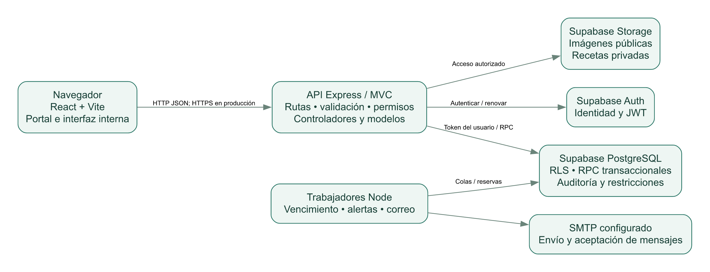


### 3.4 Restricciones y decisiones

- Importes en quetzales para la operación; el presupuesto estratégico se expresa en dólares estadounidenses. No se integra conversión de moneda.
- Fechas de negocio en America/Guatemala; almacenamiento de instantes con zona horaria. No asumir la zona del equipo del usuario.
- Máximo de 50 productos por pedido/operación según validaciones. Evitar prometer capacidad ilimitada.
- Sin registro público de personal: el administrador crea cuentas. La compra pública no exige una cuenta de cliente.
- Las referencias de tarjeta o transferencia son evidencia registrada por personal, no confirmación bancaria automatizada.
- El backend conserva claves privilegiadas; nunca deben compilarse en el frontend.
- El protocolo local utiliza localhost; en producción se requiere HTTPS, dominio y configuración de CORS.


### 3.5 Criterios de aceptación de la visión

Una demostración aceptable debe completar una venta y reconstruir su efecto en stock y caja; trasladar medicamentos con recepción en destino; consultar un consolidado y un reporte por sucursal; registrar planilla y activos; cotizar un pedido desde el call center; impedir sobreventa con reservas; y demostrar que un actor sin permisos no accede ni modifica información ajena. La validación final debe ser firmada por negocio y por el responsable de pruebas.


## 4. AN — Arquitectura del negocio


### 4.1 Organización y responsabilidades

La dirección define políticas y expansión. Operaciones coordina gerentes y puntos de venta. Abastecimiento y bodega gestionan disponibilidad física. Finanzas controla movimientos, cierres, activos y planilla. El call center centraliza solicitudes remotas; cada sucursal confirma preparación y despacho. Auditoría revisa evidencias sin registrar operaciones. Tecnología administra el servicio y los accesos, sin sustituir aprobaciones comerciales.

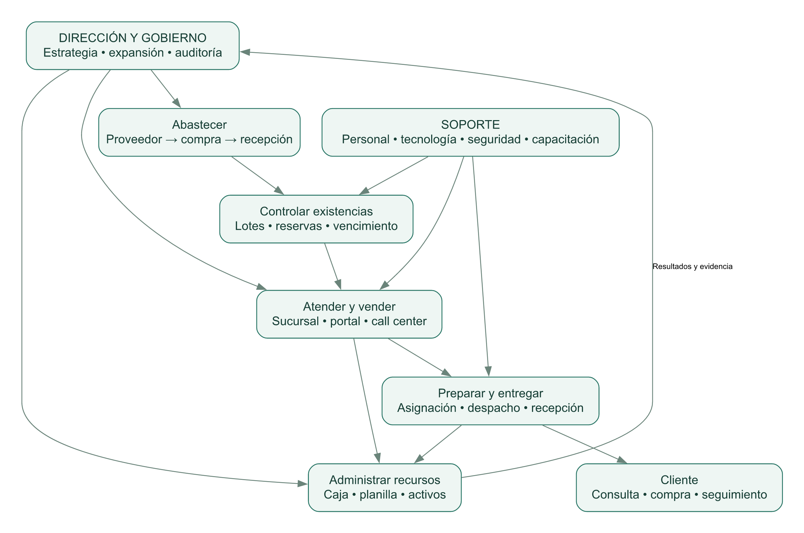


### 4.2 Procesos y resultados

| Proceso | Entrada | Resultado | Control |
| --- | --- | --- | --- |
| PR-01 Abastecimiento | Necesidad, proveedor y compra | Recepción por lote y saldo de compra | Cantidad recibida ≤ cantidad ordenada; factura consistente. |
| PR-02 Custodia de inventario | Lotes y stock mínimo | Disponibilidad y alertas | Reservas, vencimiento, FEFO y conteos aprobados. |
| PR-03 Venta presencial | Productos y medio de pago | Venta y movimiento monetario | Total calculado en servidor; receta si corresponde. |
| PR-04 Traslado | Necesidad de reposición | Salida y recepción trazables | Destino autorizado y estado del traslado. |
| PR-05 Pedido remoto | Ubicación, productos y cliente | Pedido asignado y entrega | Cobertura, horario, reserva y ETA. |
| PR-06 Tesorería operativa | Cobros y egresos | Flujo, arqueo y diferencias | Contrapartidas y períodos sin superposición. |
| PR-07 Gestión de personal | Empleados y período | Planilla histórica pagada | No duplicar sucursal/período; permisos. |
| PR-08 Patrimonio | Bien y adquisición | Inventario de activos y valor estimado | Vida útil y residual; validación contable pendiente. |
| PR-09 Actividades | Evento, cupo y participantes | Confirmaciones y recordatorios | Cupo y token temporal. |
| PR-10 Auditoría | Operaciones y cambios | Hallazgos y seguimiento | Separación de funciones y evidencia conservada. |


### 4.3 Coordinación de un pedido remoto

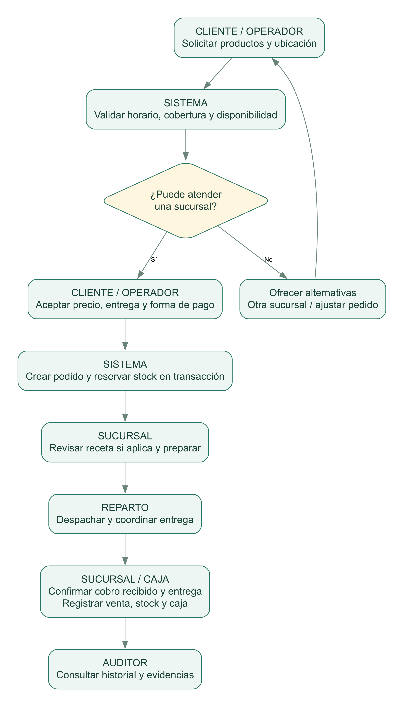

Si ninguna sucursal posee todos los productos y cobertura válida, el operador debe comunicar alternativas y ajustar la solicitud; el prototipo no divide automáticamente un pedido entre varias sucursales ni planifica una red logística de múltiples tramos. Los traslados permiten reposición, pero un traslado no equivale a una entrega final al cliente.


### 4.4 Matriz RACI propuesta

| Actividad | Dirección | Gerencia | Bodega | Caja / venta | Call center | Auditor | TI |
| --- | --- | --- | --- | --- | --- | --- | --- |
| Aprobar expansión | A/R | C | I | I | C | C | C |
| Recibir medicamentos | I | A | R | I | I | C | I |
| Contar y solicitar baja | I | A | R | I | I | C | I |
| Aprobar ajuste | I | A/R | C | I | I | C | I |
| Registrar venta/cobro | I | A | C | R | I | C | I |
| Asignar pedido | I | A | C | C | R | I | I |
| Revisar cierre | I | A | I | R | I | C | I |
| Consultar auditoría | A | C | I | I | I | R | C |
| Administrar cuentas | A | C | I | I | I | C | R |

R = ejecuta; A = responsable último; C = consultado; I = informado. La matriz es organizacional propuesta. El rol ADMIN conserva facultades amplias por diseño del prototipo; se recomienda separar administración técnica, autorización financiera y revisión de auditoría antes de operación real.


### 4.5 Información y segregación de funciones

La sucursal es el eje de alcance para inventario, caja, empleados y pedidos. Medicamentos y proveedores constituyen catálogos compartidos. La identificación del usuario se vincula a un perfil, y las autorizaciones específicas complementan los roles. Los cambios de precio, aprobaciones de stock, revisión de receta y confirmación de pagos deben ser trazables. No basta con ocultar un botón: las comprobaciones se mantienen en la API y PostgreSQL.


## 5. Estrategia RUP aplicada al proyecto

RUP se utiliza como marco iterativo, dirigido por casos de uso y centrado en arquitectura y riesgos. IBM describe las fases Inicio, Elaboración, Construcción y Transición [R1–R2]. En este proyecto se propone una adaptación proporcional al prototipo. La correspondencia con artefactos existentes es retrospectiva: no se afirma que hubo un contrato RUP o aprobaciones históricas que no estén registradas.

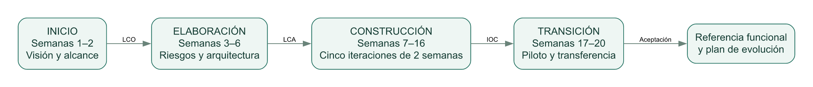

| Fase | Trabajo principal | Artefactos | Hito y condición |
| --- | --- | --- | --- |
| Inicio, 2 semanas | Comprender problema, alcance, interesados y costo preliminar | Visiones VN/VS, caso de negocio, riesgos y casos de uso iniciales | LCO: acuerdo sobre problema, alcance, actores y viabilidad. |
| Elaboración, 4 semanas | Validar arquitectura, reglas críticas y modelo de datos | Arquitectura AN/técnica, E-R, prototipos de reserva/RLS e interfaz | LCA: arquitectura demostrable y riesgos técnicos prioritarios mitigados. |
| Construcción, 10 semanas | Cinco iteraciones de implementación y pruebas integradas | Código, migraciones, pruebas, manuales y trazabilidad | IOC: flujos críticos completos y sin defectos bloqueantes. |
| Transición, 4 semanas | Piloto, capacitación, corrección y transferencia | Evidencias de aceptación, operación, respaldo y backlog | Aceptación: responsables, limitaciones y plan de despliegue aprobados. |


### 5.1 Disciplinas RUP y artefactos concretos

| Disciplina | Aplicación en NexoFarma | Evidencia / producto |
| --- | --- | --- |
| Modelado de negocio | Procesos, actores, RACI y cadena de valor | VN, AN y figuras 2–3. |
| Requisitos | RF/RNF/RN, casos de uso y aceptación | Capítulos 6–8. |
| Análisis y diseño | Entidades, estados, componentes y seguridad | Migraciones, modelo E-R, arquitectura y decisiones. |
| Implementación | Incrementos funcionales y revisiones | src/, frontend/src/, scripts/ y migraciones. |
| Pruebas | Reglas, API, permisos, interfaz y accesibilidad | tests/, frontend/tests/ y resultados registrados. |
| Despliegue | Servicio web, variables, jobs y respaldo | Dockerfile y docs/OPERACION.md; producción pendiente. |
| Gestión de configuración y cambios | Versionado, migraciones y línea base | Git; no reescribir migraciones ya aplicadas. |
| Gestión del proyecto | Riesgos, responsables, iteraciones y hitos | Plan propuesto y registro de decisiones. |
| Entorno | Herramientas, dependencias y convenciones | Node, npm, Vite, Supabase y archivos de configuración. |


### 5.2 Plan de iteraciones de construcción

| Iteración | Prioridad funcional | Riesgo a resolver | Criterio de salida |
| --- | --- | --- | --- |
| C1 | Sucursales, usuarios, lotes y seguridad | Acceso indebido y datos inconsistentes | RLS y validaciones verificadas. |
| C2 | Ventas, caja, anulación y planilla | Duplicación o transacciones parciales | Reintento idempotente y reversión auditada. |
| C3 | Traslados, call center y reservas | Sobreventa y promesas inválidas | Reservas y selección de sucursal consistentes. |
| C4 | Portal, receta, pago recibido y seguimiento | Privacidad y entrega sin aprobación | Receta privada y cobro/entrega atómicos. |
| C5 | Compras, alertas, eventos, reportes y UX | Carga operativa y errores de interacción | Flujos E2E, exportación y revisión accesible. |


### 5.3 Gestión de cambios y definición de terminado

Cada cambio debe registrar solicitante, justificación, requisitos afectados, impacto en datos, permisos, pruebas y documentación. El responsable de negocio prioriza; arquitectura evalúa consistencia y seguridad; QA verifica aceptación. Cambiar una regla de reserva o caja exige revisar casos de uso, SQL, API e interfaz, no solo el formulario.

- El incremento satisface los criterios de aceptación y mantiene reglas de negocio.
- Las migraciones se prueban desde una base vacía y sobre la versión anterior cuando corresponda.
- Las pruebas apropiadas pasan y no quedan errores bloqueantes sin resolución aceptada.
- Los mensajes no indican éxito si el servidor rechazó la operación.
- La documentación y la matriz de trazabilidad reflejan el comportamiento final.
- Se registra quién aprobó la demostración; la aprobación de código no se confunde con aceptación del negocio.


## 6. Análisis de requerimientos


### 6.1 Obtención, clasificación y prioridad

La fuente principal es el caso de negocio aportado. Se complementa con inspección de flujos y código y con ampliaciones solicitadas durante el prototipado. No se simulan actas de entrevista inexistentes. Se propone validar el catálogo con un representante de cada actor y registrar desacuerdos sobre responsabilidades, plazos y evidencias necesarias.

Prioridad M (imprescindible): control de localidades, inventario, ventas, traslados, caja, planilla, activos, auditoría y call center. Prioridad S (importante): compras, devoluciones, alertas, portal y reportes operativos. Prioridad C (complementaria para el caso original): eventos, inscripción, CMS y asistente. Las ampliaciones ya implementadas no deben eliminarse de la referencia, pero tampoco desplazar las pruebas de los controles críticos.


### 6.2 Catálogo funcional y criterios comprobables

| ID / capacidad | Requisito verificable | Aceptación / evidencia |
| --- | --- | --- |
| RF-01 Sucursales y stands | Registrar tipo, dirección, departamento, coordenadas y estado. | Alta válida aparece en alcance y catálogo; inválida se rechaza.; src/config/resources.js |
| RF-02 Cuentas y perfiles | Crear usuarios desde ADMIN y asignar rol y sucursal. | El registro público está deshabilitado y un perfil no autorizado no opera.; src/controllers/account.controller.js |
| RF-03 Catálogo de medicamentos | Administrar nombre, principio activo, precio, estado y requisito de receta. | El catálogo público excluye costos y datos de lotes.; src/controllers/public-catalog.controller.js |
| RF-04 Inventario por lote | Conservar medicamento, sucursal, lote, costo, cantidad y vencimiento. | No aceptar reservas superiores a cantidad ni lotes inconsistentes.; database/001_schema.sql |
| RF-05 Recepción de inventario | Registrar entrada con lote, vencimiento, costo y motivo. | La entrada genera incremento e historial en la misma transacción.; database/002_operations.sql |
| RF-06 Despacho FEFO | Consumir primero unidades disponibles próximas a vencer. | Excluir vencidos y reservas de otros pedidos.; database/002_operations.sql |
| RF-07 Venta presencial | Calcular total en servidor y registrar detalle, stock y caja. | Una falla revierte todos los efectos; reintentar no duplica.; tests/database.test.js |
| RF-08 Anulación de venta | Conservar venta original y generar restitución/contrapartida autorizada. | No duplicar anulación ni anular venta con devolución parcial.; database/017_pharmacy_operations.sql |
| RF-09 Traslados | Registrar salida de origen y recepción en destino como hechos separados. | Solo recepción válida incrementa inventario destino.; database/002_operations.sql |
| RF-10 Disponibilidad remota | Presentar sucursales que atienden todos los productos, cobertura, pago y ETA. | No ofrecer como apta una sucursal sin existencias o fuera de cobertura.; src/controllers/operation.controller.js |
| RF-11 Pedido telefónico | Crear pedido con cliente, dirección, ubicación y sucursal. | Confirmar reserva y precio pactado; no confiar en totales del cliente.; frontend/src/pages/CallCenterPage.jsx |
| RF-12 Reasignación | Cambiar sucursal de pedido permitido y recalcular reservas/estimación. | Si destino no cumple, conservar asignación y reservas originales.; tests/database.test.js |
| RF-13 Portal público | Consultar productos y confirmar pedidos sin cuenta de personal. | El servidor verifica precio, stock, sucursal y cobertura al confirmar.; src/controllers/portal-order.controller.js |
| RF-14 Carrito | Agregar, quitar y ajustar unidades entre 1 y 99 en este navegador. | No representar el carrito como una reserva.; frontend/src/utils/cart.js |
| RF-15 Cotización y cupón | Mostrar subtotal, envío, descuento y total aceptado. | Un cambio de precio exige cotizar de nuevo.; database/012_order_quote.sql |
| RF-16 Receta privada | Cargar imagen admitida y revisar por personal autorizado. | Bloquear preparación si requiere aprobación pendiente/rechazada.; database/011_private_prescriptions.sql |
| RF-17 Cobro y entrega | Registrar el cobro recibido y la entrega del pedido. | La transición autorizada produce venta, stock y caja una sola vez.; database/009_order_lifecycle.sql |
| RF-18 Seguimiento | Consultar un pedido con código privado y mostrar estado. | Un código inválido no revela información del pedido.; src/controllers/portal-order.controller.js |
| RF-19 Cancelación y expiración | Liberar reservas cuando corresponde por estado o tiempo. | No cancelar un pedido despachado por el flujo público.; tests/order-lifecycle.test.js |
| RF-20 Movimientos de caja | Registrar ingresos/egresos y medio de pago con origen y actor. | Revertir con contrapartida, sin borrar movimiento original.; database/002_operations.sql |
| RF-21 Arqueo de caja | Registrar efectivo contado, esperado y diferencia en un período. | No permitir períodos superpuestos ni ocultar diferencias con ajustes.; database/017_pharmacy_operations.sql |
| RF-22 Planilla | Pagar una planilla mensual de sucursal con detalle histórico. | No duplicar período; conservar salario y ajustes realmente pagados.; database/002_operations.sql |
| RF-23 Activos | Registrar bienes por sucursal y estimar depreciación lineal. | Mostrar adquisición, residual y vida útil; etiquetar valor estimado.; frontend/src/config/modules.js |
| RF-24 Auditoría | Registrar actor, fecha, acción, entidad y cambios. | No permitir edición ordinaria del historial; restringir lectura por rol.; database/001_schema.sql |
| RF-25 Reportes consolidados | Consultar caja, stock, planilla, activos y atrasos según alcance. | Gerente no obtiene sucursales ajenas; auditor obtiene lectura autorizada.; frontend/src/pages/ReportsPage.jsx |
| RF-26 Tablas y exportación | Buscar globalmente, filtrar columnas, ordenar y exportar XLSX/imprimir. | Exportar todas las coincidencias en orden, no solo página visible.; frontend/src/components/ReportTable.jsx |
| RF-27 Mínimos y vencimientos | Generar alertas de vencido, próximo a vencer y stock bajo. | No duplicar alertas del mismo ciclo de deduplicación.; database/014_alerts_suppliers_events.sql |
| RF-28 Proveedores y compras | Crear orden, recibir parcialmente y registrar pagos de lo recibido. | No recibir más de lo ordenado ni pagar por encima del saldo admitido.; tests/pharmacy-operations.test.js |
| RF-29 Conteos y bajas | Solicitar conteo, baja o devolución a proveedor con motivo. | Aprobación autorizada; conteo obsoleto no modifica stock.; database/017_pharmacy_operations.sql |
| RF-30 Devolución de cliente | Registrar cantidad y reembolso limitado a lo vendido. | No volver al stock vendible; registrar cuarentena y evitar doble devolución.; tests/pharmacy-operations.test.js |
| RF-31 Autorizaciones específicas | Administrar aprobación de receta/pago/stock y cambio de precio por cuenta. | Revocación bloquea una nueva acción aunque la interfaz esté abierta.; database/017_pharmacy_operations.sql |
| RF-32 Correo transaccional | Encolar y enviar alertas, pedidos y actividades mediante SMTP. | Registrar aceptación/reintento/error sin atribuir lectura al destinatario.; src/services/email-worker.js |
| RF-33 Diseño de correo | Editar marca, texto, colores y tipografía con vista previa. | Solo ADMIN modifica y el contenido se escapa.; frontend/src/pages/EmailDesignPage.jsx |
| RF-34 Eventos | Publicar foto, descripción, fecha, hora y sucursal. | Borradores no aparecen en calendario público.; src/controllers/events.controller.js |
| RF-35 Inscripción | Reservar cupo temporal, confirmar correo y cancelar participación. | El cupo se protege y el enlace pendiente vence a las dos horas.; database/016_email_design_enrollment.sql |
| RF-36 Recordatorio | Notificar a participantes confirmados antes de la actividad. | No duplicar recordatorio de la misma fecha ni enviar a cancelados.; tests/enrollment-design.test.js |
| RF-37 Contenido público | Editar misión, visión, programas y preguntas frecuentes. | Solo ADMIN publica cambios y el cliente solo ve contenido activo.; database/013_content_audit.sql |
| RF-38 Asistente de consulta | Ofrecer FAQ, opciones y búsquedas de productos normalizadas. | No ejecutar SQL libre ni tratar texto del usuario como instrucción de BD.; src/services/product-search.js |
| RF-39 Autocompletado | Sugerir productos con normalización de tildes y mayúsculas. | Navegación por teclado y descarte de respuestas antiguas.; frontend/src/components/ProductAutocomplete.jsx |
| RF-40 Avisos UX | Distinguir estados y confirmar operaciones destructivas con SweetAlert2. | Cancelar confirmación no envía ni aplica la operación.; frontend/src/services/user-feedback.js |
| RF-41 Preferencias de sonido | Permitir activar/desactivar sonidos y consultar avisos de la sesión. | El valor inicial es desactivado y los mensajes visuales permanecen.; frontend/src/components/ExperienceTools.jsx |
| RF-42 Diagnóstico técnico | Exponer health y ready con significado distinto. | Health informa proceso; ready comprueba una consulta a Supabase.; src/app.js |


### 6.3 Requisitos no funcionales

| ID | Requisito / criterio | Estado o validación |
| --- | --- | --- |
| RNF-01 Seguridad | Autenticación y autorización por rol/sucursal en API y RLS; probar denegaciones directas. | Implementado y pruebas locales; revisión de seguridad independiente pendiente. |
| RNF-02 Integridad | Una operación no deja efectos parciales; no stock negativo ni exceso de reserva. | Transacciones y restricciones implementadas. |
| RNF-03 Idempotencia | Repetir una solicitud con igual clave no duplica; misma clave con datos diferentes se rechaza. | Implementado en operaciones críticas; conservar contrato en clientes nuevos. |
| RNF-04 Privacidad | No publicar costos, salarios, lotes privados ni recetas; enlaces privados de vida limitada. | Implementado por endpoints y Storage; revisar retención y obligaciones aplicables. |
| RNF-05 Rendimiento | Meta propuesta: p95 ≤2 s para consulta operativa bajo carga acordada, excluyendo servicios externos. | No medido a escala nacional; falta volumen/concurrencia definidos. |
| RNF-06 Disponibilidad | Meta propuesta de producción ≥99.5% mensual; definir ventanas y monitorización. | No acreditado ni contratado como SLA. |
| RNF-07 Recuperación | Proponer RPO ≤24 h y RTO ≤4 h para piloto; validar restauración integral. | Copias y guía existen; prueba integral y herramientas por completar. |
| RNF-08 Escalabilidad | Separar aplicación sin estado, límites compartidos y workers supervisados. | Diseño evolutivo; limitador actual por proceso. |
| RNF-09 Accesibilidad | Teclado, foco visible, etiquetas, contraste y movimiento reducido; referencia WCAG A/AA. | Axe en cinco pantallas representativas; no certificación completa. |
| RNF-10 Usabilidad | ≥90% de tareas críticas sin ayuda en prueba propuesta con usuarios reales. | Pruebas de interfaz automatizadas; estudio con usuarios pendiente. |
| RNF-11 Mantenibilidad | MVC, módulos declarativos, migraciones y pruebas; documentación por cambio. | Implementado como convención del repositorio. |
| RNF-12 Observabilidad | Trazar salud, colas, fallos y latencia; distinguir aceptación SMTP de lectura. | Health/ready y estados existentes; métricas centralizadas propuestas. |
| RNF-13 Compatibilidad | Navegadores modernos con diseño adaptable; validar escritorio y móvil. | E2E en Edge/Chromium; matriz ampliada propuesta. |
| RNF-14 Interoperabilidad | JSON, identificadores y estados estables; integración futura mediante API autorizada. | API implementada; versionado formal/OpenAPI pendientes. |
| RNF-15 Trazabilidad temporal | Instantes con zona y presentación de negocio en Guatemala. | Implementado; no usar zona local del equipo como regla de negocio. |
| RNF-16 Protección de exportaciones | Exportar solo alcance autorizado y columnas visibles; texto como texto, números como números. | Pruebas de XLSX e impresión implementadas. |


### 6.4 Reglas de negocio

| ID | Regla y consecuencia |
| --- | --- |
| RN-01 | Existencia disponible = cantidad del lote − reservas, excluyendo vencidos e inactivos según la operación. No confundir con cantidad física registrada. |
| RN-02 | FEFO consume lotes elegibles por vencimiento próximo; no autoriza vender vencidos. |
| RN-03 | Precios, descuentos, cantidades y cobertura se validan en servidor; conservar valores pactados del pedido. |
| RN-04 | La reserva se crea al confirmar el pedido; el carrito y una consulta de disponibilidad no reservan. |
| RN-05 | Si la reserva pendiente expira o el pedido se cancela válidamente, las unidades se liberan una sola vez. |
| RN-06 | No preparar un pedido que requiere receta mientras su revisión esté pendiente o rechazada. |
| RN-07 | Pagar al recibir significa registrar cobro recibido; seleccionar tarjeta no realiza un cargo en línea. |
| RN-08 | El traslado descuenta origen al despachar; destino incrementa al confirmar recepción. |
| RN-09 | Reversión de caja conserva el movimiento y registra contrapartida. No borrar evidencia para cuadrar saldos. |
| RN-10 | Una planilla pagada conserva sus importes; el catálogo actual de salarios no reescribe la historia. |
| RN-11 | ADMIN crea cuentas y autorizaciones; los roles operativos con sucursal requieren asignación válida. |
| RN-12 | La disponibilidad para reparto exige todos los productos, sucursal elegible, cobertura y horario admitido. |
| RN-13 | La estimación es preparación + techo(distancia/velocidad × 60). No representa tráfico, ruta vial ni GPS. |
| RN-14 | Los cupones respetan vigencia, mínimo y usos; una cancelación no implica automáticamente recuperar su consumo. |
| RN-15 | La recepción acumulada de una compra no supera lo ordenado; pagos no superan el valor admitido de lo recibido. |
| RN-16 | Un conteo físico se compara contra una existencia observada; si el stock cambió, se rechaza su aprobación y se debe recontar. |
| RN-17 | Una devolución de cliente no reincorpora producto al inventario vendible; conserva registro en cuarentena. |
| RN-18 | No reembolsar más unidades que las vendidas ni anular la venta completa después de una devolución parcial. |
| RN-19 | El cierre registra contado, esperado y diferencia; no permite períodos superpuestos de la misma sucursal. |
| RN-20 | La inscripción pendiente vigente reserva cupo; la confirmación exige el enlace de correo y acción explícita. |
| RN-21 | Recordatorios solo para confirmados; cancelar o cambiar la fecha modifica la elegibilidad de la cola. |
| RN-22 | Auditoría de base no es evidencia inalterable frente a un administrador total de infraestructura; ese control requiere medidas adicionales. |


### 6.5 Supuestos, dependencias y requisitos pendientes

Se asume conectividad en puntos de venta, personal capacitado y registro oportuno de hechos físicos. La aplicación no conoce una entrega no registrada ni detecta automáticamente un faltante físico. Los horarios no cruzan medianoche en la configuración actual. El seguimiento depende de conservar el código privado; perderlo exige contactar a la sucursal y verificar identidad por un procedimiento externo.

Antes de producción deben acordarse tamaño de la red, transacciones por hora, usuarios concurrentes, políticas de devolución y caducidad, retención de auditoría/recetas, objetivos de disponibilidad y recuperación, y responsables de revisar cada alerta. No existe una pasarela bancaria seleccionada ni un dominio de producción contratado dentro de la evidencia revisada.


## 7. Casos de uso del sistema

Los casos describen comportamiento esperado del prototipo. Cada flujo alterno debe conservar datos consistentes y dar una instrucción accionable. Los permisos descritos se subordinan al alcance y a las autorizaciones específicas; no constituyen una autorización nueva para cualquier perfil.


### CU-01 — Administrar una localidad

| Elemento | Especificación |
| --- | --- |
| Actor principal | ADMIN |
| Precondición | Existe sesión y datos de ubicación válidos. |
| Disparador | Se requiere incorporar una farmacia o stand. |
| Flujo principal | 1. Abrir Sucursales y crear registro.; 2. Indicar código, tipo, departamento, dirección, coordenadas y configuración de entrega.; 3. Guardar y recibir confirmación del servidor.; 4. Comprobar alcance y visibilidad pública cuando corresponda. |
| Alternos / errores | Código duplicado, horario inválido o coordenadas fuera de rango: rechazar sin crear registro. |
| Postcondición | Sucursal persistida con auditoría; desactivación posterior no elimina su historia. |
| Requisitos asociados | RF-01 |


### CU-02 — Administrar cuenta y permisos

| Elemento | Especificación |
| --- | --- |
| Actor principal | ADMIN |
| Precondición | Existe responsabilidad aprobada de acceso y sucursal cuando aplica. |
| Disparador | Ingreso o cambio de funciones de una persona. |
| Flujo principal | 1. Crear cuenta desde administración.; 2. Asignar rol y sucursal; no tomar rol del correo o metadatos del navegador.; 3. Revisar autorizaciones específicas de receta, pago, stock y precio.; 4. Verificar acceso autorizado y una denegación prevista. |
| Alternos / errores | Si creación del perfil falla, el flujo de alta intenta compensar la cuenta creada; informar pendientes si la compensación falla. |
| Postcondición | Cuenta y perfil coherentes; usuario desactivado no debe seguir operando. |
| Requisitos asociados | RF-02, RF-31 |


### CU-03 — Consultar catálogo y ayuda

| Elemento | Especificación |
| --- | --- |
| Actor principal | Cliente / personal |
| Precondición | Servicio público disponible; no requiere cuenta de personal. |
| Disparador | Usuario necesita un producto o información. |
| Flujo principal | 1. Abrir catálogo o página informativa.; 2. Escribir nombre o principio activo y elegir sugerencia.; 3. Aplicar sucursal/categoría y revisar disponibilidad.; 4. Usar ayuda guiada o contactar sucursal si faltan datos. |
| Alternos / errores | Sin coincidencias: ofrecer limpiar filtros o ajustar término. Falla de red: informar sin mostrar éxito. |
| Postcondición | Consulta sin cambios de stock; no se revelan costos ni documentos privados. |
| Requisitos asociados | RF-03, RF-37, RF-38, RF-39, RF-41 |


### CU-04 — Recibir medicamentos

| Elemento | Especificación |
| --- | --- |
| Actor principal | Bodega / gerencia autorizada |
| Precondición | Medicamento y sucursal válidos; lote y vencimiento consistentes. |
| Disparador | Llega mercancía al establecimiento. |
| Flujo principal | 1. Abrir Registrar entrada o recepción de compra.; 2. Identificar lote, vencimiento, cantidad y costo cuando aplica.; 3. Registrar motivo o factura en el flujo de compra.; 4. Confirmar y verificar existencia e historial. |
| Alternos / errores | Rechazar cantidades inválidas o cambio inconsistente de vencimiento para un lote existente. |
| Postcondición | Inventario e historial actualizados atómicamente. |
| Requisitos asociados | RF-04, RF-05 |


### CU-05 — Registrar una venta

| Elemento | Especificación |
| --- | --- |
| Actor principal | Vendedor / cajero / gerencia autorizada |
| Precondición | Existencias elegibles; datos de receta según producto. |
| Disparador | Cliente compra en sucursal. |
| Flujo principal | 1. Seleccionar sucursal y productos con cantidades.; 2. Indicar forma de pago y referencia de receta si corresponde.; 3. Confirmar; servidor calcula precios y valida FEFO.; 4. Consultar comprobante interno y efecto en caja. |
| Alternos / errores | Stock insuficiente o reservado: revertir cabecera, detalles, lotes y caja. Reintento: devolver resultado idempotente. |
| Postcondición | Venta pagada, consumo e ingreso registrados; comprobante no es factura fiscal certificada. |
| Requisitos asociados | RF-06, RF-07 |


### CU-06 — Anular o revertir una operación

| Elemento | Especificación |
| --- | --- |
| Actor principal | Gerencia / ADMIN autorizado |
| Precondición | Operación elegible, motivo y permisos vigentes. |
| Disparador | Se detecta un registro que debe compensarse. |
| Flujo principal | 1. Abrir registro y acción de anulación/reversión.; 2. Escribir motivo.; 3. Revisar advertencia SweetAlert y confirmar expresamente.; 4. Consultar original, contrapartida e historial. |
| Alternos / errores | Elegir Volver sin cambios no envía la operación. Una devolución parcial impide anular toda la venta. |
| Postcondición | Se conserva evidencia original y no se duplica la compensación. |
| Requisitos asociados | RF-08, RF-20, RF-40 |


### CU-07 — Trasladar y recibir medicamentos

| Elemento | Especificación |
| --- | --- |
| Actor principal | Bodega origen y destino autorizadas |
| Precondición | Localidades distintas y stock no reservado disponible. |
| Disparador | Otra sucursal requiere reposición. |
| Flujo principal | 1. Seleccionar origen, destino y productos.; 2. Despachar traslado; registrar salida.; 3. Destino revisa y confirma recepción física.; 4. Verificar lote recibido y responsable de recepción. |
| Alternos / errores | No recibir dos veces ni recibir desde una cuenta sin alcance sobre destino. |
| Postcondición | Stock de origen y destino refleja cada etapa; conserva estado del traslado. |
| Requisitos asociados | RF-09 |


### CU-08 — Atender llamada y asignar farmacia

| Elemento | Especificación |
| --- | --- |
| Actor principal | CALL_CENTER / personal autorizado |
| Precondición | Cliente, dirección y coordenadas conocidas; servicios disponibles. |
| Disparador | Llamada solicitando medicamentos. |
| Flujo principal | 1. Ingresar productos y ubicación en Call center.; 2. Consultar opciones con disponibilidad conjunta, distancia y ETA.; 3. Comunicar precio, pago y estimación; obtener aceptación.; 4. Crear pedido y reserva en sucursal seleccionada.; 5. Reasignar antes del despacho solo si el destino cumple. |
| Alternos / errores | Sin farmacia apta: comunicar alternativas; no prometer stock. Reasignación fallida conserva reserva previa. |
| Postcondición | Pedido con precio reservado y sucursal responsable. |
| Requisitos asociados | RF-10, RF-11, RF-12 |


### CU-09 — Comprar por portal

| Elemento | Especificación |
| --- | --- |
| Actor principal | Cliente |
| Precondición | Carrito válido; conexión y dirección/ubicación completas. |
| Disparador | Cliente decide confirmar compra. |
| Flujo principal | 1. Agregar productos y ajustar cantidades.; 2. Completar entrega, ubicación, sucursal, pago y correo opcional.; 3. Adjuntar receta si corresponde y solicitar cotización.; 4. Revisar subtotal, envío, cupón y total.; 5. Confirmar total aceptado y guardar código privado. |
| Alternos / errores | Precio cambió: recotizar. Sin cobertura o stock: no crear pedido parcial. Archivo inválido: indicar formatos y tamaño. |
| Postcondición | Pedido y reserva atómicos; carrito no representa cargo ni reserva previa. |
| Requisitos asociados | RF-13, RF-14, RF-15 |


### CU-10 — Preparar, despachar y cobrar pedido

| Elemento | Especificación |
| --- | --- |
| Actor principal | Personal de sucursal autorizado |
| Precondición | Pedido de su alcance; receta revisada cuando se exige. |
| Disparador | Sucursal inicia preparación y entrega. |
| Flujo principal | 1. Abrir pedido y revisar receta mediante enlace privado si aplica.; 2. Aprobar o rechazar con autorización específica.; 3. Pasar a PREPARANDO y luego EN_CAMINO con repartidor.; 4. Confirmar cobro recibido y entrega; registrar referencia salvo efectivo.; 5. Verificar venta y movimiento monetario generados. |
| Alternos / errores | Receta pendiente bloquea preparación. Pago rechazado no genera cobro ni entrega. Retorno físico usa DEVUELTO. |
| Postcondición | Entrega/cobro válidos en transacción; no es cargo bancario online. |
| Requisitos asociados | RF-16, RF-17 |


### CU-11 — Seguir o cancelar pedido

| Elemento | Especificación |
| --- | --- |
| Actor principal | Cliente con código privado |
| Precondición | Código de un pedido existente. |
| Disparador | Cliente quiere conocer avance o cancelar antes del despacho. |
| Flujo principal | 1. Abrir seguimiento e introducir código.; 2. Consultar estado y ETA; actualización periódica o manual.; 3. Si aún es elegible, solicitar cancelación.; 4. Confirmar en SweetAlert y comprobar liberación. |
| Alternos / errores | Código inválido no revela datos; pedido en camino no ofrece cancelación pública. Expiración se procesa por job. |
| Postcondición | Seguimiento no modifica stock; cancelación válida libera reservas una sola vez. |
| Requisitos asociados | RF-18, RF-19 |


### CU-12 — Registrar caja y realizar arqueo

| Elemento | Especificación |
| --- | --- |
| Actor principal | Cajero / gerencia autorizada |
| Precondición | Sucursal, monto y período válidos. |
| Disparador | Ocurre movimiento monetario o termina turno. |
| Flujo principal | 1. Registrar ingreso/egreso con concepto y forma de pago cuando es manual.; 2. Revisar movimientos originados por ventas, compras y planilla.; 3. Indicar turno y efectivo contado físicamente.; 4. Comparar saldo esperado, contado y diferencia; conservar observación. |
| Alternos / errores | Turnos superpuestos o final futuro: rechazo. Revertir con contrapartida, no borrar. |
| Postcondición | Cierre evidencia diferencia; no crea dinero para cuadrar. |
| Requisitos asociados | RF-20, RF-21 |


### CU-13 — Gestionar planilla y activos

| Elemento | Especificación |
| --- | --- |
| Actor principal | Gerencia / ADMIN autorizado |
| Precondición | Empleados y activos asociados a sucursal. |
| Disparador | Pago mensual o actualización de patrimonio. |
| Flujo principal | 1. Revisar empleados activos y salarios.; 2. Registrar período y ajustes explícitos; confirmar pago operativo.; 3. Registrar bienes con adquisición, residual y vida útil.; 4. Consultar planilla histórica y valor estimado de activos. |
| Alternos / errores | Período ya pagado: no duplicar. Valores incompatibles de activo: rechazar. |
| Postcondición | Gasto y detalle conservados; no se afirma cumplimiento completo de nómina legal. |
| Requisitos asociados | RF-22, RF-23 |


### CU-14 — Auditar y exportar información

| Elemento | Especificación |
| --- | --- |
| Actor principal | Auditor / dirección / gerente según alcance |
| Precondición | Sesión autorizada y filtros válidos. |
| Disparador | Revisión de operaciones o solicitud de consolidado. |
| Flujo principal | 1. Seleccionar período y sucursal autorizada.; 2. Consultar caja, inventario, activos y atrasos.; 3. Aplicar búsqueda y filtros de tabla; ordenar columnas.; 4. Exportar XLSX o imprimir y guardar como PDF.; 5. Relacionar hallazgo con registro, actor y movimiento. |
| Alternos / errores | Sin datos: mostrar estado vacío; falla de API: mensaje y opción de reintentar. No exportar otra sucursal. |
| Postcondición | Archivo refleja coincidencias y orden; inventario actual no se convierte en balance histórico. |
| Requisitos asociados | RF-24, RF-25, RF-26, RF-42 |


### CU-15 — Revisar alertas y notificaciones

| Elemento | Especificación |
| --- | --- |
| Actor principal | Bodega / gerencia / auditoría autorizada |
| Precondición | Generación de alertas activa y configuración SMTP válida para envío. |
| Disparador | Vencimiento, mínimo o cambio de pedido. |
| Flujo principal | 1. Consultar tipo, estado y sucursal de alerta.; 2. Verificar existencia física y priorizar acción.; 3. Gestionar reposición, baja o contacto por flujo autorizado.; 4. Consultar cola de correo, reintentos o errores. |
| Alternos / errores | SMTP rechaza: conservar pendiente/reintento y no afirmar recepción. Alerta no sustituye revisión del responsable. |
| Postcondición | Hallazgo visible con seguimiento operativo; correo no garantiza lectura. |
| Requisitos asociados | RF-27, RF-32 |


### CU-16 — Comprar a proveedor y pagar recepción

| Elemento | Especificación |
| --- | --- |
| Actor principal | Bodega / gerencia / caja según acción |
| Precondición | Proveedor activo y compra autorizada. |
| Disparador | Necesidad de abastecimiento. |
| Flujo principal | 1. Crear orden con productos, cantidades y costos.; 2. Recibir total o parcialmente con factura, lote y vencimiento.; 3. Revisar acumulado y saldo de mercancía recibida.; 4. Registrar pago ya efectuado y su egreso. |
| Alternos / errores | Sobre-recepción, factura inconsistente o pago excesivo: rechazar sin efectos parciales. |
| Postcondición | Compra PARCIAL/RECIBIDA, stock y caja trazables; no transferencia bancaria automática. |
| Requisitos asociados | RF-28 |


### CU-17 — Aprobar inventario y devolver producto

| Elemento | Especificación |
| --- | --- |
| Actor principal | Bodega solicita; gerencia autoriza |
| Precondición | Lote o detalle vendido identificado y motivo justificado. |
| Disparador | Conteo, baja o devolución. |
| Flujo principal | 1. Registrar conteo físico o unidades a retirar y motivo.; 2. Revisor compara existencia observada y estado actual.; 3. Confirmar o rechazar solicitud con autorización.; 4. Para cliente, seleccionar detalle y cantidad; registrar reembolso limitado y cuarentena. |
| Alternos / errores | Conteo obsoleto exige recontar. No retirar reservado ni devolver dos veces lo mismo. |
| Postcondición | Ajuste auditado; devolución cliente no aumenta inventario vendible. |
| Requisitos asociados | RF-29, RF-30 |


### CU-18 — Publicar actividad e inscribir participante

| Elemento | Especificación |
| --- | --- |
| Actor principal | ADMIN y cliente |
| Precondición | Evento futuro publicado, cupo y correo del participante. |
| Disparador | Programación de actividad o solicitud de inscripción. |
| Flujo principal | 1. ADMIN configura foto, descripción, fecha/hora, cupo y anticipación.; 2. Cliente solicita lugar en calendario público.; 3. Correo contiene enlace temporal; cliente confirma mediante botón.; 4. Worker genera recordatorio para confirmados; cliente puede cancelar.; 5. ADMIN revisa inscritos y personaliza diseño de correo. |
| Alternos / errores | Cupo agotado o enlace inválido/expirado: rechazar. No confirmar automáticamente al abrir enlace. |
| Postcondición | Inscripción y cola trazables; recordatorio deduplicado y contenido escapado. |
| Requisitos asociados | RF-33, RF-34, RF-35, RF-36 |


## 8. Modelo de estados y matriz de trazabilidad

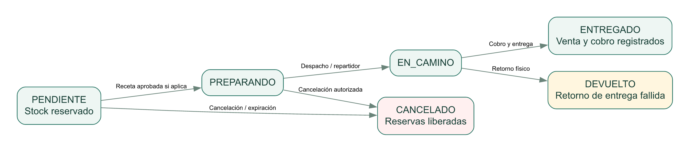

La venta de mostrador y la entrega de un pedido comparten efectos contables de operación, pero tienen orígenes distintos. El estado CANCELADO no es lo mismo que DEVUELTO; tampoco equivale a REEMBOLSO_PENDIENTE del pago. Las reglas finales se verifican en las funciones SQL y no deben deducirse únicamente de colores o etiquetas.

| Dimensión | Estados relevantes | Precaución |
| --- | --- | --- |
| Pedido | PENDIENTE, PREPARANDO, EN_CAMINO, ENTREGADO, CANCELADO, DEVUELTO | Respetar transiciones y permisos. |
| Pago | PENDIENTE, PAGADO, RECHAZADO, REEMBOLSO_PENDIENTE | Registrar referencia no confirma por sí sola un pago bancario. |
| Receta | NO_REQUIERE, PENDIENTE, APROBADA, RECHAZADA | No preparar si requiere aprobación y aún no la tiene. |
| Compra | PENDIENTE, PARCIAL, RECIBIDA | La recepción determina stock; el pago es una dimensión adicional. |
| Inscripción | PENDIENTE, CONFIRMADA, CANCELADA | La reserva pendiente tiene vencimiento; apertura del enlace no confirma. |
| Cola de correo | PENDIENTE, ENVIANDO, ENVIADO, ERROR | ENVIADO refleja procesamiento/aceptación, no lectura. |

| Objetivo | Requisito | Caso de uso | Evidencia principal |
| --- | --- | --- | --- |
| OBJ-05 | RF-01 | CU-01 | src/config/resources.js |
| OBJ-02 | RF-02 | CU-02 | src/controllers/account.controller.js |
| OBJ-01 | RF-03 | CU-03 | src/controllers/public-catalog.controller.js |
| OBJ-01 | RF-04 | CU-04 | database/001_schema.sql |
| OBJ-01 | RF-05 | CU-04 | database/002_operations.sql |
| OBJ-01 | RF-06 | CU-05 | database/002_operations.sql |
| OBJ-02 | RF-07 | CU-05 | tests/database.test.js |
| OBJ-02 | RF-08 | CU-06 | database/017_pharmacy_operations.sql |
| OBJ-04 | RF-09 | CU-07 | database/002_operations.sql |
| OBJ-07 | RF-10 | CU-08 | src/controllers/operation.controller.js |
| OBJ-07 | RF-11 | CU-08 | frontend/src/pages/CallCenterPage.jsx |
| OBJ-03 | RF-12 | CU-08 | tests/database.test.js |
| OBJ-03 | RF-13 | CU-09 | src/controllers/portal-order.controller.js |
| OBJ-08 | RF-14 | CU-09 | frontend/src/utils/cart.js |
| OBJ-02 | RF-15 | CU-09 | database/012_order_quote.sql |
| OBJ-01 | RF-16 | CU-10 | database/011_private_prescriptions.sql |
| OBJ-02 | RF-17 | CU-10 | database/009_order_lifecycle.sql |
| OBJ-03 | RF-18 | CU-11 | src/controllers/portal-order.controller.js |
| OBJ-01 | RF-19 | CU-11 | tests/order-lifecycle.test.js |
| OBJ-02 | RF-20 | CU-12 | database/002_operations.sql |
| OBJ-02 | RF-21 | CU-12 | database/017_pharmacy_operations.sql |
| OBJ-05 | RF-22 | CU-13 | database/002_operations.sql |
| OBJ-05 | RF-23 | CU-13 | frontend/src/config/modules.js |
| OBJ-02 | RF-24 | CU-14 | database/001_schema.sql |
| OBJ-05 | RF-25 | CU-14 | frontend/src/pages/ReportsPage.jsx |
| OBJ-08 | RF-26 | CU-14 | frontend/src/components/ReportTable.jsx |
| OBJ-06 | RF-27 | CU-15 | database/014_alerts_suppliers_events.sql |
| OBJ-01 | RF-28 | CU-16 | tests/pharmacy-operations.test.js |
| OBJ-01 | RF-29 | CU-17 | database/017_pharmacy_operations.sql |
| OBJ-02 | RF-30 | CU-17 | tests/pharmacy-operations.test.js |
| OBJ-02 | RF-31 | CU-02 | database/017_pharmacy_operations.sql |
| OBJ-03 | RF-32 | CU-15 | src/services/email-worker.js |
| OBJ-08 | RF-33 | CU-18 | frontend/src/pages/EmailDesignPage.jsx |
| OBJ-08 | RF-34 | CU-18 | src/controllers/events.controller.js |
| OBJ-08 | RF-35 | CU-18 | database/016_email_design_enrollment.sql |
| OBJ-08 | RF-36 | CU-18 | tests/enrollment-design.test.js |
| OBJ-08 | RF-37 | CU-03 | database/013_content_audit.sql |
| OBJ-07 | RF-38 | CU-03 | src/services/product-search.js |
| OBJ-08 | RF-39 | CU-03 | frontend/src/components/ProductAutocomplete.jsx |
| OBJ-08 | RF-40 | CU-06 | frontend/src/services/user-feedback.js |
| OBJ-08 | RF-41 | CU-03 | frontend/src/components/ExperienceTools.jsx |
| OBJ-05 | RF-42 | CU-14 | src/app.js |

La matriz permite comprobar cobertura sin declarar una prueba individual para cada celda. Cuando una evidencia apunta a un archivo de configuración, la aceptación requiere además recorrer el flujo o consultar la restricción ejecutable. Una prueba automatizada aprobada verifica el escenario descrito por esa prueba, no todos los comportamientos posibles del requisito.


## 9. Análisis de factibilidad

Las tres factibilidades consideradas son técnica, económica y operativa. El análisis usa evidencia del prototipo y supuestos explícitos. La factibilidad legal, ambiental o comercial puede requerir estudios independientes; no se incluye como una cuarta factibilidad ni se da por aprobada por el solo hecho de usar un servicio en la nube.


### 9.1 Factibilidad técnica

El prototipo demuestra compatibilidad entre React/Vite, Express, Supabase Auth, PostgreSQL y Storage. Las operaciones críticas están centralizadas en RPC transaccionales; los modelos reciben la respuesta como JSON y los permisos se verifican en más de una capa. Las migraciones y pruebas permiten reconstruir la base de aplicación en un entorno de verificación. Esto reduce incertidumbre funcional, pero no demuestra capacidad de infraestructura para todas las localidades del país.

| Aspecto | Evidencia | Condición de viabilidad |
| --- | --- | --- |
| Tecnología disponible | Dependencias y aplicación ejecutable | Mantener versiones compatibles y revisar actualizaciones. |
| Integridad de datos | NUMERIC, claves, checks, RPC, FEFO y reservas | Conservar reglas en servidor y pruebas de regresión. |
| Seguridad | JWT, perfiles, RLS y Storage privado | Rotación de secretos, revisión de privilegios y exposición mínima. |
| Nube | Supabase PostgreSQL/Auth/Storage | Contratar capacidad y recuperación acordes a volumen y retención. |
| Conectividad | Aplicación web conectada | Internet confiable y procedimiento de contingencia en sucursales. |
| Escala | Diseño con separación de capas | Medir carga, índices, límites compartidos y trabajos de exportación. |
| Operación | Dockerfile, health/ready, scripts y guías | Host público, HTTPS, supervisión, alertas y restauración ensayada. |
| Integración futura | API JSON y modelos de pedidos | Formalizar contratos, versionado y autenticación de integraciones. |

Alternativas: A) hojas de cálculo por punto, de bajo costo inicial pero con consolidación e integridad débiles; B) ERP/comercio de terceros, que exige evaluación de licencias, adaptación y dependencia; C) evolución del prototipo, que conserva ajuste al negocio pero requiere un equipo responsable de seguridad, pruebas y soporte. No se compararon ofertas comerciales reales ni se concluye que una alternativa es económicamente superior sin cotizaciones.

Dictamen técnico: viable de forma condicionada como prototipo y base de desarrollo. La salida a producción requiere pruebas de carga y recuperación, elección del alojamiento, revisión de permisos y manejo de múltiples procesos. El correo y el cálculo de ETA deben tratarse como dependencias externas o estimaciones, respectivamente.


### 9.2 Factibilidad económica

El caso menciona una inversión potencial de US$5,000,000 para el proyecto de expansión. No se interpreta como precio del software. El siguiente desglose es un escenario ilustrativo de distribución del techo de inversión, expresado en USD y sin conversión a quetzales. No constituye cotización, compromiso de compra ni estimación fiscal; debe sustituirse por presupuestos aprobados.

| Rubro del programa integral | USD | Participación |
| --- | --- | --- |
| Locales, adecuación y habilitación física | 1,650,000 | 33% |
| Inventario inicial de expansión | 1,400,000 | 28% |
| Equipamiento, activos y logística | 650,000 | 13% |
| Desarrollo e implementación tecnológica | 500,000 | 10% |
| Nube, conectividad y soporte: escenario de 3 años | 300,000 | 6% |
| Capacitación organizacional y gestión del cambio | 150,000 | 3% |
| Contingencia del programa | 350,000 | 7% |
| TOTAL | 5,000,000 | 100% |

La habilitación y el inventario consumen recursos independientes de la aplicación. El número de localidades, sus alquileres, aforo, equipamiento y permisos no se han validado. Por ello la distribución solo ilustra cómo separar inversión corporativa de inversión en sistemas y evitar atribuir todo el monto al prototipo.

| Desglose tecnológico ilustrativo | USD |
| --- | --- |
| Análisis funcional y validación de requisitos | 50,000 |
| Arquitectura y diseño de solución | 60,000 |
| Backend, integridad e integraciones | 120,000 |
| Frontend y experiencia de usuario | 90,000 |
| QA, seguridad y pruebas de aceptación | 75,000 |
| Preparación y migración de datos | 45,000 |
| Automatización de despliegue y operación | 35,000 |
| Documentación técnica y transferencia a desarrolladores | 25,000 |
| TOTAL DESARROLLO | 500,000 |

Los US$25,000 de documentación y transferencia técnica son entregables del equipo de desarrollo; los US$150,000 de capacitación organizacional corresponden al despliegue y adopción por usuarios de la red. En una contratación deben revisarse para evitar doble contabilización. No se incluyen contratos bancarios, impuestos o condiciones regulatorias que no hayan sido cotizados.

| Operación tecnológica anual: hipótesis | USD/año | Nota |
| --- | --- | --- |
| Servicios de nube y observabilidad | 40,000 | Bolsa de planificación; no tarifa actual de Supabase. |
| Conectividad de localidades | 36,000 | Supuesto de red a dimensionar; no cotización de operadores. |
| Soporte y mantenimiento operativo | 24,000 | Revisar cobertura horaria y personal necesario. |
| TOTAL ANUAL | 100,000 | 3 años = 300,000. |


#### 9.2.1 Evaluación por escenarios del componente tecnológico

Se evalúa únicamente una inversión tecnológica inicial hipotética I = US$500,000 y un gasto anual O = US$100,000 durante tres años. Los beneficios B representan ahorro/beneficio operativo incremental anual que debe medirse: menos pérdidas, menos reprocesos y mejor coordinación. No se asumen ingresos bursátiles ni se confunden ventas brutas con beneficios. No se usan tasas de descuento o inflación no justificadas.

Costo de tres años = I + 3O = US$800,000. Resultado neto simple = 3B − (I + 3O). ROI simple del período = [3B − (I + 3O)] / (I + 3O). Recuperación simple = I / (B − O), solo si B > O y si los beneficios se obtienen de forma estable; no incorpora calendario real de desembolsos.

| Escenario | B anual USD | Neto anual B−O | Neto 3 años | ROI simple 3 años | Recuperación simple |
| --- | --- | --- | --- | --- | --- |
| Conservador | 250,000 | 150,000 | −50,000 | −6.25% | 3.33 años |
| Base ilustrativo | 450,000 | 350,000 | 550,000 | 68.75% | 1.43 años |
| Favorable | 650,000 | 550,000 | 1,150,000 | 143.75% | 0.91 años |

Punto de equilibrio simple del horizonte de tres años: B = O + I/3 = US$266,666.67 anuales. El escenario conservador no recupera el costo tecnológico dentro de tres años, por lo que no corresponde declarar rentabilidad asegurada. Estos cálculos no evalúan el retorno de los US$5 millones de expansión: para ello faltan ventas incrementales, márgenes, alquileres, costos físicos, capital de trabajo y horizonte financiero del negocio completo.


#### 9.2.2 Beneficios medibles y sensibilidad

| Beneficio hipotético | Cómo levantar evidencia | Riesgo de sobreestimación |
| --- | --- | --- |
| Menos vencimientos | Comparar costo de bajas por lote antes/después | Atribuir al sistema un cambio en mezcla de productos. |
| Menos diferencias de inventario | Conteos y valor de faltantes con metodología fija | Contar como ahorro una corrección de registro sin recuperación física. |
| Menos reproceso administrativo | Muestrear horas por cierre, reporte y conciliación | Suponer que todas las horas liberadas reducen gasto real. |
| Mejora de entrega | Tiempos registrados y reclamos definidos | Usar ETA como tiempo real de ruta. |
| Mayor disponibilidad | Pedidos atendidos y ventas incrementales con margen | Usar ventas brutas como beneficio neto. |

Dictamen económico: no es posible certificar rentabilidad con datos disponibles. La inversión tecnológica resulta justificable solo si el piloto y las cotizaciones sostienen los beneficios y costos elegidos. Se recomienda una liberación por hitos RUP, con revisión al terminar Elaboración y antes del despliegue nacional.


### 9.3 Factibilidad operativa

El sistema es operativamente viable si los responsables registran hechos físicos a tiempo, los usuarios conocen sus permisos y existe un procedimiento de atención a diferencias y fallas. La calidad del catálogo inicial, los saldos de apertura, la conciliación de lotes y el padrón de empleados son condiciones de arranque, no tareas que el software pueda omitir.

| Condición | Acción propuesta | Responsable |
| --- | --- | --- |
| Personal y roles | Designar usuarios titulares/suplentes y revisar segregación | Dirección y gerencia. |
| Datos iniciales | Depurar códigos, contar inventario y aprobar saldos de apertura | Bodega y finanzas. |
| Capacitación | Talleres por rol y simulación de errores/reintentos | Operaciones y equipo de formación. |
| Contingencia | Definir operación limitada ante caída, sin prometer stock no verificado | Gerencia y TI. |
| Alertas | Asignar responsable y plazo de revisión por vencimiento/reposición | Abastecimiento. |
| Entrega | Confirmar quién prepara, despacha y registra retorno/cobro | Sucursal y reparto. |
| Auditoría | Procedimiento de hallazgos, evidencia y acciones correctivas | Auditoría. |
| Soporte | Canal, prioridades, escalamiento y horario | TI / proveedor acordado. |

Piloto propuesto: una farmacia, un stand y un operador central; no se afirma que ese piloto se haya realizado. Ejecutar recepción, venta, cancelación, traslado, cierre, pago de planilla, pedido con receta y caída de conectividad simulada. Aceptar el piloto cuando los actores completen tareas, las diferencias estén explicadas y los responsables firmen la evidencia.

Dictamen operativo: favorable condicionado a capacitación, conectividad y calidad de datos. La principal limitación no es una pantalla faltante, sino que los hechos del mundo físico y las responsabilidades deben coincidir con los registros del sistema.


## 9.4 Riesgos y mitigaciones

| ID / riesgo | Prob. / impacto | Mitigación y responsable |
| --- | --- | --- |
| RSK-01 Internet o API indisponible | Media / Alto | Monitorización y contingencia acordada; TI/gerencia. |
| RSK-02 Sobreventa por concurrencia | Media / Alto | Reservas transaccionales y pruebas concurrentes; backend/QA. |
| RSK-03 Privilegios indebidos | Media / Alto | RLS, revisión de roles y rotación de secretos; seguridad/ADMIN. |
| RSK-04 Datos iniciales incorrectos | Alta / Alto | Conteos y conciliación antes de migrar; bodega/finanzas. |
| RSK-05 Correos rechazados/no vistos | Media / Medio | Cola, reintento y revisión de estado; operaciones/TI. |
| RSK-06 ETA inexacta | Alta / Alto | Comunicar estimación y medir tiempos; logística. |
| RSK-07 Restauración incompleta | Media / Alto | Probar base, Auth y binarios Storage; TI. |
| RSK-08 Uso indebido de recetas | Media / Alto | Acceso temporal, retención y revisión de permisos; seguridad. |
| RSK-09 Rechazo del usuario | Media / Alto | Piloto por rol y sesiones de usabilidad; operaciones. |
| RSK-10 Costos o beneficios errados | Alta / Alto | Cotizaciones y control por hitos; patrocinador. |
| RSK-11 Exportación muy grande | Media / Medio | Generación en servidor y límites acordados; arquitectura. |
| RSK-12 Evidencia administrativa alterable | Baja-media / Alto | Exportación o repositorio de evidencia independiente; auditoría/TI. |


## 10. Modelo de información y diagrama E-R


### 10.1 Criterio de diseño

El modelo utiliza entidades maestras, cabeceras y detalles, movimientos e historiales. Las relaciones muchos a muchos se resuelven con entidades de detalle; por ejemplo, una venta contiene medicamentos mediante detalle_venta. El lote pertenece a la combinación sucursal/medicamento y conserva vencimiento y costo. Los importes usan NUMERIC y las cantidades son enteros; las restricciones declaradas y las funciones transaccionales complementan la normalización.

Separar perfil de empleado evita suponer que todo usuario es trabajador de una sucursal. Separar pedido de venta permite reservar y preparar sin registrar un cobro prematuro. Separar compra de recepción y pago distingue compromiso, mercancía físicamente recibida y egreso registrado. Las colas y claves de idempotencia son entidades técnicas y aparecen diferenciadas en los esquemas privados.


### 10.2 Lectura de los diagramas

La notación utiliza PK para clave primaria y FK para clave foránea. En cada extremo de una relación se muestra 1, 0..1 o 0..N. Un FK nullable permite que el hijo no tenga padre asignado. Un FK único limita la cantidad de hijos por padre a 0..1. La cardinalidad expresa la restricción estructural, no que siempre exista al menos un hijo. Las reglas de estado, capacidad o importes no se representan completamente mediante cardinalidades.

El diagrama general muestra entidades para orientación; las vistas por dominio muestran claves y relaciones legibles. Son vistas de un único modelo, no bases de datos independientes. auth.users pertenece al servicio de identidad y no se incluyen todos los detalles internos de Auth o Storage. Los cinco diagramas y sus fuentes SVG/DOT se entregan junto al documento.


### 10.3 E-R general

PK = clave primaria; FK = clave foránea. Cardinalidades: 1, 0..1 y 0..N. Se muestran relaciones físicas declaradas; auth.users es administrada por Supabase. El anexo C contiene todos los campos y restricciones.

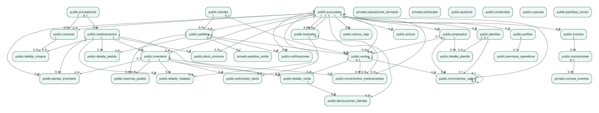


### 10.4 E-R de inventario y movimientos

PK = clave primaria; FK = clave foránea. Cardinalidades: 1, 0..1 y 0..N. Se muestran relaciones físicas declaradas; auth.users es administrada por Supabase. El anexo C contiene todos los campos y restricciones.

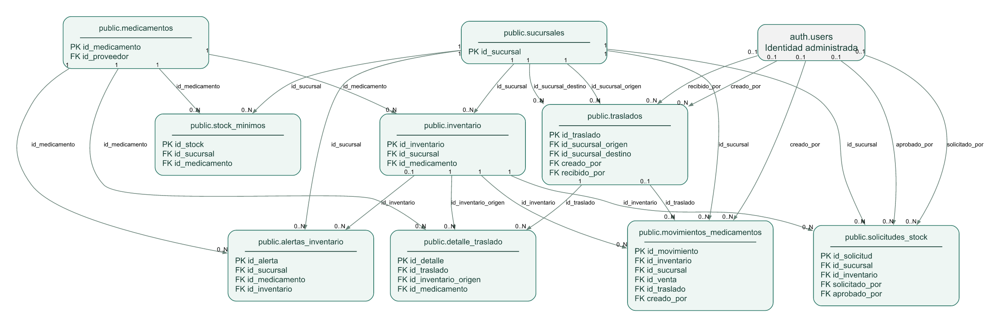


### 10.5 E-R de ventas y pedidos

PK = clave primaria; FK = clave foránea. Cardinalidades: 1, 0..1 y 0..N. Se muestran relaciones físicas declaradas; auth.users es administrada por Supabase. El anexo C contiene todos los campos y restricciones.

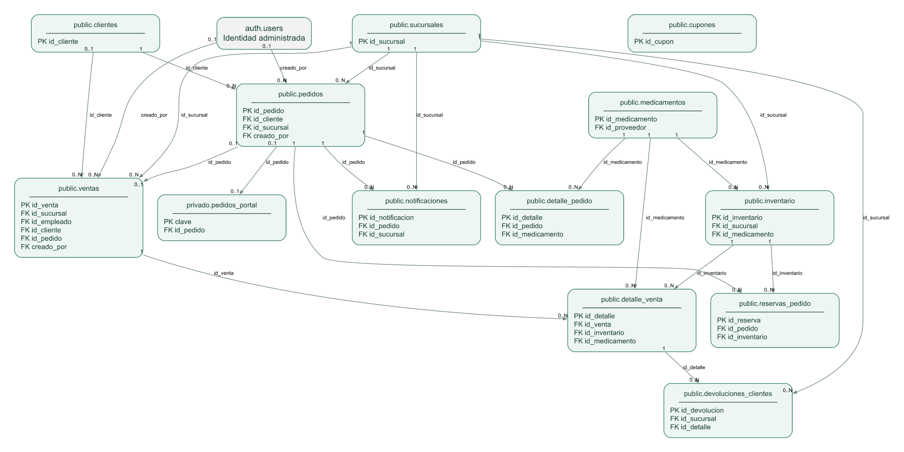


### 10.6 E-R de finanzas, compras y patrimonio

PK = clave primaria; FK = clave foránea. Cardinalidades: 1, 0..1 y 0..N. Se muestran relaciones físicas declaradas; auth.users es administrada por Supabase. El anexo C contiene todos los campos y restricciones.

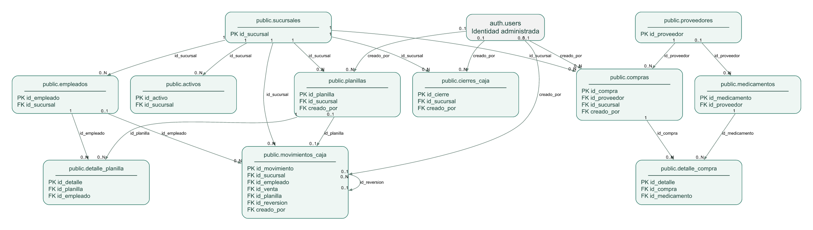


### 10.7 E-R de seguridad, actividades y soporte

PK = clave primaria; FK = clave foránea. Cardinalidades: 1, 0..1 y 0..N. Se muestran relaciones físicas declaradas; auth.users es administrada por Supabase. El anexo C contiene todos los campos y restricciones.

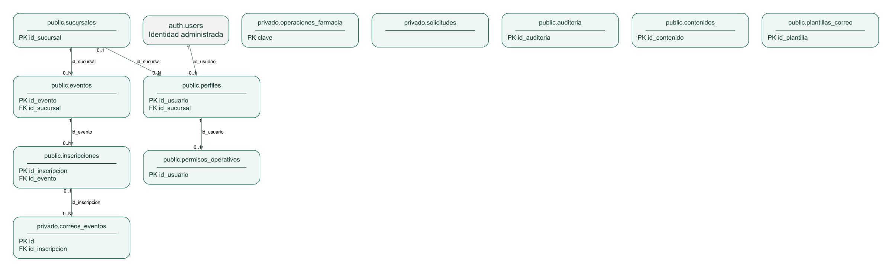


## 11. Desarrollo de la aplicación y utilización de la nube


### 11.1 Stack y distribución de responsabilidades

| Componente | Tecnología / ubicación | Responsabilidad |
| --- | --- | --- |
| Interfaz | React 19 + Vite 8, frontend/src/ | Páginas públicas e internas, formularios, carrito, tablas y avisos. |
| API | Node.js y Express 5, src/ | Autenticación, validación HTTP, autorización, controladores y modelos. |
| Datos | PostgreSQL en Supabase, database/ | Restricciones, RLS, transacciones RPC y auditoría. |
| Identidad | Supabase Auth | Usuarios, sesión y JWT; perfil de aplicación separado. |
| Archivos | Supabase Storage | Imágenes de productos/eventos y recetas en acceso privado. |
| Correo | Nodemailer y SMTP configurable | Notificaciones HTML con respaldo de texto, reintento y cola. |
| Calendario | FullCalendar + Luxon | Actividades en sucursal y fechas de Guatemala. |
| Reportes | ExcelJS e impresión del navegador | XLSX real y vista imprimible para PDF. |
| UX | SweetAlert2 y componentes propios | Avisos por severidad, confirmaciones, sonidos opcionales y foco. |
| Pruebas | Node test, PGlite, Playwright y axe | Reglas de SQL/API, frontend y escenarios de navegador. |

Las versiones corresponden a las dependencias declaradas al corte; package-lock.json fija las resoluciones concretas. Para el entorno reproducible se recomienda Node 24, consistente con la guía de operación y el contenedor del proyecto, y ejecutar npm ci. No se declara que todas las futuras versiones mayores sean compatibles sin pruebas.


### 11.2 Flujo MVC y operación transaccional

Una solicitud llega a una ruta, pasa por middleware de seguridad y autenticación, se valida en el controlador y se delega al modelo. El modelo llama a Supabase con el token de usuario o a funciones privilegiadas acotadas cuando el flujo público lo exige. Las operaciones críticas ejecutan una RPC que confirma o revierte todos los cambios relacionados. La respuesta JSON actualiza el estado de React; el cliente no decide el total ni el rol efectivo.

| Ruta de código | Uso como referencia de desarrollo |
| --- | --- |
| src/app.js | Composición de endpoints públicos, seguridad, diagnósticos y servicio del frontend compilado. |
| src/routes/business.routes.js | Operaciones internas, reportes y CRUD declarativo. |
| src/config/resources.js | Campos admitidos, roles, filtros y recursos de la API. |
| src/services/operation-validation.js | Validación de operaciones tradicionales y límites del contrato. |
| src/controllers/pharmacy-operations.controller.js | Comandos de compras, devoluciones, conteos y caja. |
| src/models/portal-service.model.js | Acceso privilegiado acotado para servicios públicos; no exponerlo al navegador. |
| frontend/src/config/modules.js | Módulos, etiquetas, campos y permisos visibles. |
| frontend/src/config/operations.js | Acciones y formularios operativos. |
| frontend/src/services/api-client.js | Solicitud JSON, token, renovación y reintento controlado. |
| database/002_operations.sql y sucesivas | Reglas ejecutables de negocio. |


### 11.3 Uso real de Supabase

PostgreSQL guarda los datos de aplicación y ejecuta funciones de negocio. Auth administra identidad y almacena sus tablas en el esquema auth; las reglas de aplicación siguen en perfiles [R3]. RLS limita filas según actor y alcance [R4]. Storage contiene objetos binarios y aplica controles de acceso asociados a políticas [R5]. Estas capacidades están integradas en el prototipo; no debe afirmarse que se usa Realtime o Edge Functions si no están presentes en el flujo implementado.

Imágenes del catálogo y eventos son públicas cuando el flujo lo requiere. Las recetas no lo son: el personal autorizado solicita un enlace temporal, con vida de 120 segundos en el flujo actual. El enlace no es una autorización general para divulgar el documento. La API valida tipos y tamaños admitidos y limita carga de imágenes a 5 MB.


### 11.4 Despliegue actual y propuesto

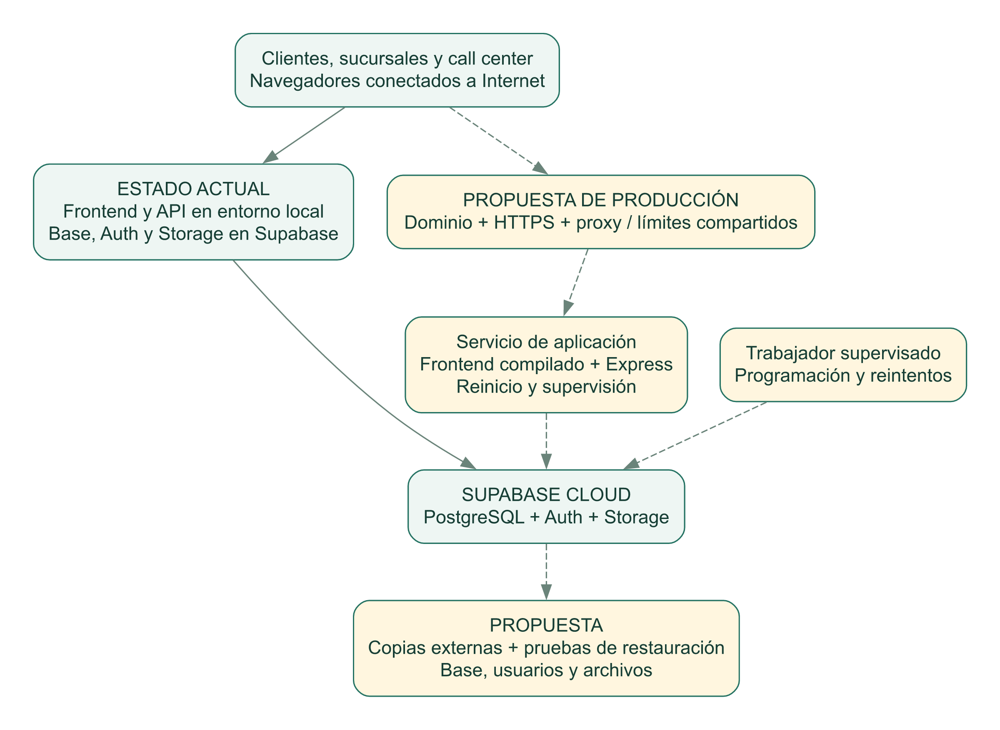

Actualmente se ha trabajado con frontend/API locales y servicios Supabase remotos. La preparación incluye Dockerfile, variables de entorno, endpoints de diagnóstico y opción de servir frontend compilado desde Express. No se encontró evidencia de dominio/DNS público configurado, host productivo contratado o alta disponibilidad validada. La figura no atribuye esos componentes al estado actual.


### 11.5 Procedimiento reproducible de instalación

- Instalar Node compatible y disponer de un proyecto Supabase separado para desarrollo.
- Instalar dependencias raíz y frontend con npm ci y npm --prefix frontend ci.
- Crear .env desde .env.example y cargar secretos por un canal privado; nunca pegarlos en documentación ni Git.
- Configurar DATABASE_URL y las variables Supabase de acuerdo con el proyecto correcto.
- Ejecutar npm run db:migrate; después npm run db:seed solo en un entorno autorizado para datos de demostración.
- Verificar npm run db:check; revisar que la conexión corresponda al proyecto previsto.
- Levantar API con npm run dev y frontend con npm run ui. En PowerShell puede usarse npm.cmd.
- Abrir http://localhost:5173; /api/health en puerto 3000 verifica proceso y /api/ready consulta disponibilidad del servicio de datos.


### 11.6 Publicación de referencia

```text
npm ci
npm --prefix frontend ci
npm run db:migrate
# PowerShell: variables de compilación y servicio
$env:VITE_API_URL='/api'
npm run ui:build
$env:SERVE_FRONTEND='true'
npm start
```

Los comandos son una referencia técnica, no una orden para modificar producción sin revisión. Antes de publicarla: definir dominio, HTTPS, CORS, variables privadas, copias, reinicio automático, monitorización y responsables. El contenedor está preparado como artefacto; no se asegura su ejecución validada en este equipo si Docker no estaba disponible. La ejecución de migraciones se realiza explícitamente y no desde cada réplica al arrancar.


### 11.7 Variables y secretos

| Grupo | Ejemplos de nombres | Control |
| --- | --- | --- |
| Base y autenticación | DATABASE_URL, SUPABASE_URL, claves Supabase del backend | No mostrar valores; limitar acceso y rotar por procedimiento. |
| Frontend | VITE_API_URL | Solo configuración pública; no incluir clave privilegiada. |
| Correo | SMTP_HOST, SMTP_PORT, SMTP_SECURE, SMTP_USER, SMTP_PASS, SMTP_FROM | Contraseña de aplicación en .env/gestor de secretos; no guardar en documentación. |
| Destinatarios y jobs | ALERT_EMAIL_TO, EMAIL_WORKER_ENABLED, EXPIRATION_JOB_ENABLED | Revisar destinatarios reales y evitar doble envío por canales. |
| Enlaces y web | PUBLIC_SITE_URL, CORS_ORIGINS, SERVE_FRONTEND | URL alcanzable por destinatarios y origen permitido exacto. |

Las recetas, direcciones y códigos de seguimiento también son información sensible. Los registros de prueba y las capturas no deben revelar datos reales. La configuración SMTP existente no se reproduce aquí y no se envían correos como parte de generar este documento.


### 11.8 Contratos principales de API

| Método / ruta | Propósito | Acceso / observación |
| --- | --- | --- |
| GET /api/health y /api/ready | Diagnóstico de proceso y consulta de datos | Público; no devuelven secretos. |
| POST /api/login; /api/refresh | Iniciar y renovar sesión | Límites de intentos; token y perfil de aplicación. |
| GET /api/catalogo; /api/contenido | Productos y páginas informativas | Público; no costos privados. |
| POST /api/disponibilidad | Evaluar sucursales para entrega | Personal autorizado; ubicación y productos. |
| POST /api/ventas | Venta presencial | Sesión, permiso y clave de idempotencia. |
| POST /api/traslados; /api/traslados/:id/recibir | Despacho y recepción | Alcance de origen/destino según acción. |
| POST /api/pedidos; PATCH /api/pedidos/:id/estado | Pedido telefónico e interno | Actor autorizado y transición válida. |
| POST /api/tienda/cotizar; /api/tienda/pedidos | Cotizar y confirmar portal | Público con validaciones y límites; total aceptado. |
| POST /api/tienda/seguimiento; /api/tienda/cancelar | Seguimiento y cancelación pública | Código privado; no exponerlo como identificador público. |
| POST /api/tienda/recetas | Carga de receta | Imagen admitida, 5 MB y flujo de intento autorizado. |
| POST /api/pedidos/:id/gestion | Revisión de receta / cobro y entrega | Personal de alcance y autorizaciones específicas. |
| POST /api/operaciones-farmacia | Compras, recepción, pagos, conteos y devoluciones | Comando validado y clave UUID en cuerpo. |
| GET /api/reportes/resumen | Reporte por alcance y período | ADMIN/GERENTE/AUDITOR según permisos y RLS. |
| POST /api/eventos/inscribirse; /api/eventos/confirmar | Inscripción y confirmación/cancelación | Público limitado; token se almacena como hash. |
| CRUD /api/{recurso} | Catálogos y listados | Whitelist declarativa; no aceptar tablas/campos arbitrarios. |

Las operaciones tradicionales reciben Idempotency-Key; operaciones-farmacia tiene accion, datos y clave en el cuerpo. No intercambiar ambos contratos. El tamaño y los campos se verifican en cada controlador. El siguiente JSON usa identificadores ficticios y no se debe ejecutar contra una base real sin preparación.

```text
POST /api/operaciones-farmacia
Authorization: Bearer <TOKEN_DE_PRUEBA>
Content-Type: application/json

{
  "accion": "compra_crear",
  "clave": "00000000-0000-4000-8000-000000000001",
  "datos": {
    "id_sucursal": 1,
    "id_proveedor": 1,
    "items": [{"id_medicamento": 1, "cantidad": 10, "costo": 5.00}]
  }
}
```


### 11.9 Procesos en segundo plano

La expiración revisa reservas pendientes al inicio y cada minuto, salvo configuración externa. La generación de alertas identifica vencimientos y mínimos. El correo consulta plantillas, encola recordatorios y toma registros mediante arrendamiento, con reintentos y un máximo de intentos. Los trabajos deben supervisarse: el servidor local apagado no envía recordatorios. Configurar un solo esquema operativo de ejecución y evitar enviar la misma finalidad por SMTP y webhook sin un criterio.

Los bloqueos y la deduplicación reducen duplicados, pero SMTP no proporciona una transacción conjunta con PostgreSQL: si el proveedor acepta y el proceso cae antes de confirmar el estado, puede existir un reintento. No describir la entrega como exactamente una vez. Usar identificador estable y revisar la cola.


### 11.10 Datos, respaldo y restauración

El proyecto incluye un script de respaldo con pg_dump/pg_restore y una guía de operación. Una copia SQL no contiene los binarios de Storage; la documentación oficial lo distingue expresamente [R6]. La estrategia integral debe abarcar datos, identidad, metadatos y objetos de archivos, además de secretos y configuración protegidos. Los respaldos de aplicación que excluyen auth y storage no sustituyen una copia integral del proyecto.

- Definir retención, cifrado, ubicación externa y responsable de copias.
- Registrar versión de migraciones y fecha del respaldo.
- Restaurar en un entorno aislado y verificar conteos, claves y acceso.
- Comprobar que recetas e imágenes referenciadas existen y respetan sus permisos.
- Ejecutar pruebas de venta/reserva y lectura de auditoría después de restaurar.
- Medir RPO y RTO reales; no declarar cumplidas las metas sin el ensayo.


## 12. Calidad, pruebas y evidencias


### 12.1 Estrategia por niveles

| Nivel | Qué verifica | Limitación |
| --- | --- | --- |
| Unidad | Normalización, carrito, formularios, exportaciones y utilidades | No cubre infraestructura remota completa. |
| Base de datos local | Migraciones, reglas, transacciones, RLS, permisos y estados | PGlite no reproduce por sí solo Auth/Storage remotos. |
| API HTTP | Rutas, validación, autenticación simulada, errores y alcance | Servicios externos se aíslan o simulan. |
| Navegador | Flujos de portal/admin, inscripciones, tablas y alertas UX | No equivale a prueba con todos los navegadores o dispositivos. |
| Accesibilidad automática | Reglas A/AA en cinco pantallas representativas con axe | No certifica accesibilidad ni sustituye prueba humana. |
| Integración externa | Conexión Supabase y aceptación SMTP verificadas durante desarrollo | Aceptación SMTP no acredita lectura; no se hace un envío por este expediente. |
| Pendiente de producción | Carga, recuperación, penetración, continuidad y usuarios reales | Debe incorporarse al plan de transición. |


### 12.2 Resultado registrado al corte

| Comprobación | Evidencia de la sesión | Interpretación |
| --- | --- | --- |
| Backend | 78 pruebas aprobadas en la última ejecución registrada del backend | Regresión funcional previa a cambios exclusivamente de interfaz. |
| Frontend unitario | 21 pruebas aprobadas | Incluye búsqueda global, XLSX, formularios y utilidades. |
| Navegador completo | 19 escenarios aprobados tras mejoras UX | Flujos de ventas, entregas, inscripciones, compras, reportes y avisos. |
| Revisión posterior de cabecera/móvil | 4 escenarios específicos aprobados | Revalidación de experiencia y páginas después del último ajuste visual. |
| Compilación | vite build finalizó correctamente | Hay aviso de tamaño del módulo ExcelJS cargado bajo demanda. |
| Accesibilidad | Sin infracciones reportadas por axe en las cinco vistas analizadas | Inventario, reportes, portada, catálogo y acceso; alcance acotado. |

Los conteos son resultados registrados durante el trabajo, no un certificado inmutable. Los comandos permiten repetirlos sobre la versión revisada. No se adjuntan métricas de carga inexistentes ni se afirma un porcentaje de cobertura de código no medido. Las capturas usan datos de prueba y no acreditan inventario real de la empresa.

```text
npm test
npm --prefix frontend test
npm --prefix frontend run build
# Windows, navegador disponible en el entorno de prueba:
$env:PLAYWRIGHT_CHANNEL='msedge'
npm --prefix frontend run test:e2e
```


### 12.3 Escenarios de aceptación del piloto

| ID | Preparación / acción | Resultado esperado |
| --- | --- | --- |
| PA-01 | Dos pedidos compiten por la última unidad | Solo uno reserva; el otro falla sin stock negativo. |
| PA-02 | Reenviar una venta con la misma clave | Mismo resultado sin nuevo cobro ni consumo. |
| PA-03 | Recibir un traslado desde otra sucursal | Denegación; destino autorizado sí recibe una sola vez. |
| PA-04 | Venta con lote vencido y lote válido | Solo se usa elegible según FEFO. |
| PA-05 | Crear pedido con receta pendiente | Reserva creada; preparación bloqueada hasta aprobación. |
| PA-06 | Cancelar antes y después de despacho | Antes libera reservas; después no permite cancelación pública. |
| PA-07 | Pagar la misma planilla dos veces | Segunda solicitud no duplica gasto. |
| PA-08 | Aprobar conteo tras otra venta | Rechazar conteo obsoleto y solicitar nueva revisión. |
| PA-09 | Filtrar reporte y exportar | XLSX/PDF contiene todas las coincidencias y respeta alcance. |
| PA-10 | Cancelar SweetAlert de acción destructiva | No se envía ni aplica la operación. |
| PA-11 | Caída de SMTP | Conservar reintento/error; no mostrar recepción falsa. |
| PA-12 | Restaurar respaldo aislado | Datos y archivos coherentes, acceso correcto y pruebas críticas pasan. |


## 13. Guía de experiencia e interfaz

La experiencia pública está separada en páginas: inicio, nosotros, promociones, servicios, programas, actividades, sucursales y ayuda; el catálogo conserva su ruta independiente. El administrador usa módulos con búsqueda y contexto de localidad. La información esencial debe presentarse antes de una confirmación, sin trasladar al cliente detalles internos que no le ayudan a decidir.

| Estado | Tratamiento | Regla para desarrolladores |
| --- | --- | --- |
| Éxito | Verde + icono + texto | Mostrar después de confirmación del servidor. |
| Error | Rojo + instrucción contextual | Conservar datos introducidos y explicar recuperación. |
| Advertencia | Ámbar + confirmación cuando corresponde | Foco inicial en opción segura; cancelar no modifica datos. |
| Información / edición | Azul + texto de estado/foco | No confundir foco de entrada con validación de negocio. |
| Carga | Indicador y texto de espera | Bloquear dobles envíos y no afirmar que se guardó. |
| Vacío | Mensaje de ausencia y alternativa | Distinguir sin datos, sin coincidencias y falla de carga. |

El botón Avisos de la cabecera abre los últimos 30 mensajes de la sesión y la preferencia de sonidos. Los sonidos están desactivados inicialmente, son opcionales y complementan texto/icono. El historial no se guarda en disco y se limpia al cerrar sesión. Los mensajes no deben incluir contraseñas, recetas ni códigos privados. Los cuadros SweetAlert se insertan dentro del dialog nativo abierto para no quedar ocultos detrás de su capa.

Los listados buscan en todos los registros recuperados, filtran por columna y ordenan; la exportación no se limita a la página visible. Esta estrategia es adecuada para la referencia funcional, pero para grandes volúmenes se debe delegar búsqueda, orden y exportación a servidor. El resultado no es una instantánea transaccional de toda la empresa si hay cambios concurrentes durante la descarga de páginas.


## 14. Transición, evolución y transferencia


### 14.1 Plan de paso a operación

- Preparar ambientes separados de desarrollo, pruebas y producción; mantener secretos fuera de Git.
- Validar con negocio requisitos, roles, políticas y saldos iniciales.
- Cerrar riesgos de Elaboración: concurrencia, seguridad y restauración.
- Publicar un entorno piloto con dominio/HTTPS y monitoreo; configurar PUBLIC_SITE_URL alcanzable.
- Capacitar por rol y ejecutar escenarios PA con representantes.
- Registrar defectos, correcciones y aceptación por hito.
- Desplegar gradualmente por región/localidad con plan de reversión y soporte.
- Revisar métricas y autorizar nuevas localidades solo con evidencia operativa.


### 14.2 Backlog priorizado de evolución

| Prioridad | Elemento | Motivo |
| --- | --- | --- |
| Alta | Restauración integral y operación supervisada | Evitar pérdida de información o caída sin recuperación. |
| Alta | Pruebas de carga y consultas/exportaciones de servidor | Demostrar capacidad de una red amplia. |
| Alta | Revisión de privilegios, secretos y retención | Reducir exposición y asegurar responsabilidades. |
| Alta | Validación con usuarios de farmacia y call center | Comprobar comprensión y tiempos reales de tarea. |
| Media | OpenAPI, versionado de API y contratos de integración | Facilitar futuros canales y equipos. |
| Media | Rutas viales y medición real de entregas | Mejorar ETA sin prometer puntualidad absoluta. |
| Media | Contabilidad, conciliación y facturación certificada | Cerrar requisitos financieros externos al prototipo. |
| Condicionada | Pasarela de pagos, SMS o WhatsApp | Requiere proveedor, contrato y reglas de operación. |
| Condicionada | Offline y sincronización | Requiere rediseño de conflictos y promesas de inventario. |


### 14.3 Entrega a desarrolladores y control de aceptación

Se entrega código como referencia funcional, migraciones, pruebas, documentos y diagramas editables. Un equipo que reimplemente puede cambiar tecnologías justificadamente, pero debe conservar contratos de negocio: reservas, FEFO, transacciones, autorizaciones, trazabilidad y criterios de aceptación. No debe reproducir limitaciones de escala del prototipo como si fueran requisitos definitivos.

| Responsable | Decisión de aceptación | Estado |
| --- | --- | --- |
| Patrocinador | Visión, alcance y prioridad del programa | Pendiente de firma. |
| Representante de operaciones | Flujos físicos, roles y contingencias | Pendiente de validación. |
| Finanzas | Saldos, planilla, activos y supuestos económicos | Pendiente de validación. |
| Arquitectura / TI | Diseño, seguridad, nube y continuidad | Pendiente de aprobación productiva. |
| QA / usuarios clave | Casos de aceptación y evidencia | Resultados automatizados disponibles; aceptación humana pendiente. |


## 15. Conclusiones

El prototipo ofrece una base coherente para los requisitos centrales: control distribuido de localidades, inventario, caja, traslados, planilla, activos, auditoría y atención remota. La implementación agrega capacidades públicas, compras, devoluciones, alertas y actividades que permiten demostrar procesos de principio a fin. La documentación transforma esa base en una referencia de requisitos y diseño, con relaciones verificables hacia el código.

La aplicación de RUP permite organizar la continuación por riesgos e hitos en lugar de agregar pantallas sin control. Las factibilidades técnica y operativa son favorables condicionadas; la económica depende de cotizaciones y resultados medidos. El uso de Supabase satisface el componente de servicios en la nube, mientras que publicar y operar toda la solución exige una transición explícita. No se acredita una operación nacional, un cumplimiento bursátil ni un retorno de inversión garantizado.


## 16. Referencias y fuentes

Fuentes externas primarias consultadas para fundamentar metodología y arquitectura. Se parafrasean; no se reproducen manuales completos. Fecha de consulta: 18 de octubre de 2026.

[R1] IBM — Project planning; cuatro fases de RUP. https://www.ibm.com/docs/en/rational-clearquest/10.0.8?topic=settings-project-planning

[R2] IBM Rational — Best Practices for Software Development Teams. https://public.dhe.ibm.com/software/rational/web/whitepapers/2003/rup_bestpractices.pdf

[R3] Supabase — Auth architecture. https://supabase.com/docs/guides/auth/architecture

[R4] Supabase — Row Level Security. https://supabase.com/docs/guides/database/postgres/row-level-security

[R5] Supabase — Storage Access Control. https://supabase.com/docs/guides/storage/security/access-control

[R6] Supabase — Database Backups. https://supabase.com/docs/guides/platform/backups

Fuentes del proyecto: README.md; docs/OPERACION.md; docs/UX-UI.md; database/001_schema.sql–017_pharmacy_operations.sql; src/app.js; src/routes/business.routes.js; src/config/resources.js; frontend/src/config/modules.js; tests/; frontend/tests/. Los nombres de archivos son referencias de trazabilidad, no enlaces a repositorios públicos.


## Anexo A. Guía rápida por perfil

| Perfil | Recorrido recomendado | Comprobación |
| --- | --- | --- |
| ADMIN | Crear sucursal → catálogos → usuarios/permisos → revisar auditoría | No compartir cuenta entre personas. |
| GERENTE | Inventario → pedidos → compras → conteos → reportes | Revisar solo alcance asignado y autorizaciones. |
| BODEGA | Entradas → traslados → solicitudes de conteo/baja | Registrar recepción real y verificar lote. |
| VENDEDOR | Consultar → venta/pedido → receta y preparación autorizada | Precio y stock se confirman en servidor. |
| CAJERO | Venta/caja → pago a proveedor autorizado → arqueo | Monto y medio de pago coinciden con hecho real. |
| CALL_CENTER | Cliente y ubicación → disponibilidad → pedido → seguimiento | Comunicar ETA como estimación y no prometer stock consultado previamente. |
| AUDITOR | Reportes → movimientos → auditoría → exportación | Lectura y hallazgos; sin alterar evidencia. |
| CLIENTE | Catálogo → carrito → entrega/pago → revisar total → confirmar | Guardar código; no introducir datos de tarjeta. |


## Anexo B. Glosario

| Término | Definición en este proyecto |
| --- | --- |
| FEFO | Primero en vencer, primero en salir; selección de lotes elegibles por vencimiento. |
| RLS | Seguridad por fila de PostgreSQL, aplicada al actor y alcance. |
| RPC | Llamada a función de base de datos que encapsula reglas y transacciones. |
| Idempotencia | Reintentar una misma solicitud sin repetir su efecto de negocio. |
| Reserva | Unidades comprometidas por pedido confirmado, distintas de la selección en carrito. |
| ETA | Tiempo/fecha estimada de entrega, no garantía ni posición GPS. |
| RPO / RTO | Pérdida temporal máxima de datos / tiempo objetivo de recuperación. |
| LCO / LCA / IOC | Hitos RUP: objetivos del ciclo, arquitectura del ciclo y capacidad operacional inicial. |
| Contrapartida | Movimiento compensatorio que conserva el original. |
| Cuarentena | Registro de producto devuelto sin reincorporación automática al stock vendible. |
| Factibilidad | Viabilidad bajo condiciones y supuestos; no prueba de rentabilidad o cumplimiento. |
| Línea base | Conjunto aprobado/versionado que sirve de referencia para cambios. |


## Anexo C. Diccionario de datos físico

Inventario de metadatos extraído de las migraciones del proyecto. Incluye public y privado: 38 tablas, 339 columnas y 69 relaciones FK. No incluye tablas internas completas de Supabase Auth/Storage ni privado.migraciones del ejecutor. Las rutas de archivos de imagen se almacenan como referencias a objetos; los binarios no están embebidos en estas tablas.


### privado.correos_eventos

Cola privada para confirmación y recordatorio de actividades.

| Campo | Tipo físico | Nulo | Clave / referencia | Predeterminado |
| --- | --- | --- | --- | --- |
| id | bigint | No | PK | IDENTITY BY DEFAULT |
| id_inscripcion | bigint | Sí | FK → public.inscripciones.id_inscripcion | — |
| clave | text | No | — | — |
| destino | text | No | — | — |
| evento | text | No | — | — |
| cuerpo | text | No | — | — |
| action_url | text | Sí | — | — |
| estado | text | No | — | 'PENDIENTE'::text |
| intentos | integer | No | — | 0 |
| proximo_intento | timestamp with time zone | No | — | now() |

| Restricción | Tipo | Definición SQL |
| --- | --- | --- |
| correos_eventos_clave_key | Única | UNIQUE (clave) |
| correos_eventos_clave_not_null | NOT NULL | NOT NULL clave |
| correos_eventos_cuerpo_not_null | NOT NULL | NOT NULL cuerpo |
| correos_eventos_destino_not_null | NOT NULL | NOT NULL destino |
| correos_eventos_estado_not_null | NOT NULL | NOT NULL estado |
| correos_eventos_evento_not_null | NOT NULL | NOT NULL evento |
| correos_eventos_id_inscripcion_fkey | Foránea | FOREIGN KEY (id_inscripcion) REFERENCES inscripciones(id_inscripcion) |
| correos_eventos_id_not_null | NOT NULL | NOT NULL id |
| correos_eventos_intentos_not_null | NOT NULL | NOT NULL intentos |
| correos_eventos_pkey | Primaria | PRIMARY KEY (id) |
| correos_eventos_proximo_intento_not_null | NOT NULL | NOT NULL proximo_intento |


### privado.operaciones_farmacia

Registro privado de claves y respuestas de comandos idempotentes.

| Campo | Tipo físico | Nulo | Clave / referencia | Predeterminado |
| --- | --- | --- | --- | --- |
| clave | uuid | No | PK | — |
| actor | uuid | No | — | — |
| accion | text | No | — | — |
| datos | jsonb | No | — | — |
| respuesta | jsonb | No | — | — |

| Restricción | Tipo | Definición SQL |
| --- | --- | --- |
| operaciones_farmacia_accion_not_null | NOT NULL | NOT NULL accion |
| operaciones_farmacia_actor_not_null | NOT NULL | NOT NULL actor |
| operaciones_farmacia_clave_not_null | NOT NULL | NOT NULL clave |
| operaciones_farmacia_datos_not_null | NOT NULL | NOT NULL datos |
| operaciones_farmacia_pkey | Primaria | PRIMARY KEY (clave) |
| operaciones_farmacia_respuesta_not_null | NOT NULL | NOT NULL respuesta |


### privado.pedidos_portal

Soporte privado del pedido público y token de seguimiento.

| Campo | Tipo físico | Nulo | Clave / referencia | Predeterminado |
| --- | --- | --- | --- | --- |
| clave | uuid | No | PK | — |
| token_hash | text | No | — | — |
| solicitud | jsonb | No | — | — |
| id_pedido | bigint | Sí | FK → public.pedidos.id_pedido | — |
| respuesta | jsonb | Sí | — | — |
| creado_en | timestamp with time zone | No | — | now() |

| Restricción | Tipo | Definición SQL |
| --- | --- | --- |
| pedidos_portal_clave_not_null | NOT NULL | NOT NULL clave |
| pedidos_portal_creado_en_not_null | NOT NULL | NOT NULL creado_en |
| pedidos_portal_id_pedido_fkey | Foránea | FOREIGN KEY (id_pedido) REFERENCES pedidos(id_pedido) |
| pedidos_portal_id_pedido_key | Única | UNIQUE (id_pedido) |
| pedidos_portal_pkey | Primaria | PRIMARY KEY (clave) |
| pedidos_portal_solicitud_not_null | NOT NULL | NOT NULL solicitud |
| pedidos_portal_token_hash_key | Única | UNIQUE (token_hash) |
| pedidos_portal_token_hash_not_null | NOT NULL | NOT NULL token_hash |


### privado.solicitudes

Registro privado de solicitudes/idempotencia de operaciones.

| Campo | Tipo físico | Nulo | Clave / referencia | Predeterminado |
| --- | --- | --- | --- | --- |
| actor | uuid | No | PK | — |
| clave | uuid | No | PK | — |
| accion | text | No | — | — |
| datos | jsonb | No | — | — |
| resultado | jsonb | No | — | — |

| Restricción | Tipo | Definición SQL |
| --- | --- | --- |
| solicitudes_accion_not_null | NOT NULL | NOT NULL accion |
| solicitudes_actor_not_null | NOT NULL | NOT NULL actor |
| solicitudes_clave_not_null | NOT NULL | NOT NULL clave |
| solicitudes_datos_not_null | NOT NULL | NOT NULL datos |
| solicitudes_pkey | Primaria | PRIMARY KEY (actor, clave) |
| solicitudes_resultado_not_null | NOT NULL | NOT NULL resultado |


### public.activos

Bienes asociados a sucursal con adquisición y parámetros de valor contable estimado.

| Campo | Tipo físico | Nulo | Clave / referencia | Predeterminado |
| --- | --- | --- | --- | --- |
| id_activo | bigint | No | PK | IDENTITY BY DEFAULT |
| codigo | character varying(30) | No | — | — |
| id_sucursal | bigint | No | FK → public.sucursales.id_sucursal | — |
| nombre | character varying(150) | No | — | — |
| descripcion | text | Sí | — | — |
| valor | numeric(14,2) | No | — | — |
| valor_residual | numeric(14,2) | No | — | 0 |
| vida_util_meses | integer | No | — | — |
| fecha_adquisicion | date | No | — | — |
| estado | text | No | — | 'ACTIVO'::text |

| Restricción | Tipo | Definición SQL |
| --- | --- | --- |
| activos_check | CHECK | CHECK (((valor_residual >= (0)::numeric) AND (valor_residual <= valor))) |
| activos_codigo_key | Única | UNIQUE (codigo) |
| activos_codigo_not_null | NOT NULL | NOT NULL codigo |
| activos_estado_check | CHECK | CHECK ((estado = ANY (ARRAY['ACTIVO'::text, 'MANTENIMIENTO'::text, 'BAJA'::text]))) |
| activos_estado_not_null | NOT NULL | NOT NULL estado |
| activos_fecha_adquisicion_not_null | NOT NULL | NOT NULL fecha_adquisicion |
| activos_id_activo_not_null | NOT NULL | NOT NULL id_activo |
| activos_id_sucursal_fkey | Foránea | FOREIGN KEY (id_sucursal) REFERENCES sucursales(id_sucursal) |
| activos_id_sucursal_not_null | NOT NULL | NOT NULL id_sucursal |
| activos_nombre_not_null | NOT NULL | NOT NULL nombre |
| activos_pkey | Primaria | PRIMARY KEY (id_activo) |
| activos_valor_check | CHECK | CHECK ((valor >= (0)::numeric)) |
| activos_valor_not_null | NOT NULL | NOT NULL valor |
| activos_valor_residual_not_null | NOT NULL | NOT NULL valor_residual |
| activos_vida_util_meses_check | CHECK | CHECK ((vida_util_meses > 0)) |
| activos_vida_util_meses_not_null | NOT NULL | NOT NULL vida_util_meses |


### public.alertas_inventario

Hallazgos de vencimiento y mínimo por sucursal/producto/lote cuando corresponde.

| Campo | Tipo físico | Nulo | Clave / referencia | Predeterminado |
| --- | --- | --- | --- | --- |
| id_alerta | bigint | No | PK | IDENTITY BY DEFAULT |
| clave | text | No | — | — |
| tipo | text | No | — | — |
| id_sucursal | bigint | No | FK → public.sucursales.id_sucursal | — |
| id_medicamento | bigint | No | FK → public.medicamentos.id_medicamento | — |
| id_inventario | bigint | Sí | FK → public.inventario.id_inventario | — |
| mensaje | text | No | — | — |
| estado | text | No | — | 'ACTIVA'::text |
| creado_en | timestamp with time zone | No | — | now() |
| enviado_en | timestamp with time zone | Sí | — | — |
| correo_estado | text | No | — | 'PENDIENTE'::text |
| intentos | integer | No | — | 0 |
| proximo_intento | timestamp with time zone | No | — | now() |

| Restricción | Tipo | Definición SQL |
| --- | --- | --- |
| alertas_inventario_clave_key | Única | UNIQUE (clave) |
| alertas_inventario_clave_not_null | NOT NULL | NOT NULL clave |
| alertas_inventario_correo_estado_not_null | NOT NULL | NOT NULL correo_estado |
| alertas_inventario_creado_en_not_null | NOT NULL | NOT NULL creado_en |
| alertas_inventario_estado_not_null | NOT NULL | NOT NULL estado |
| alertas_inventario_id_alerta_not_null | NOT NULL | NOT NULL id_alerta |
| alertas_inventario_id_inventario_fkey | Foránea | FOREIGN KEY (id_inventario) REFERENCES inventario(id_inventario) |
| alertas_inventario_id_medicamento_fkey | Foránea | FOREIGN KEY (id_medicamento) REFERENCES medicamentos(id_medicamento) |
| alertas_inventario_id_medicamento_not_null | NOT NULL | NOT NULL id_medicamento |
| alertas_inventario_id_sucursal_fkey | Foránea | FOREIGN KEY (id_sucursal) REFERENCES sucursales(id_sucursal) |
| alertas_inventario_id_sucursal_not_null | NOT NULL | NOT NULL id_sucursal |
| alertas_inventario_intentos_not_null | NOT NULL | NOT NULL intentos |
| alertas_inventario_mensaje_not_null | NOT NULL | NOT NULL mensaje |
| alertas_inventario_pkey | Primaria | PRIMARY KEY (id_alerta) |
| alertas_inventario_proximo_intento_not_null | NOT NULL | NOT NULL proximo_intento |
| alertas_inventario_tipo_check | CHECK | CHECK ((tipo = ANY (ARRAY['VENCIDO'::text, 'POR_VENCER'::text, 'STOCK_BAJO'::text]))) |
| alertas_inventario_tipo_not_null | NOT NULL | NOT NULL tipo |


### public.auditoria

Historial de cambios, actor y entidad afectada.

| Campo | Tipo físico | Nulo | Clave / referencia | Predeterminado |
| --- | --- | --- | --- | --- |
| id_auditoria | bigint | No | PK | IDENTITY BY DEFAULT |
| tabla | text | No | — | — |
| registro | text | No | — | — |
| accion | text | No | — | — |
| id_sucursal | bigint | Sí | — | — |
| actor | uuid | Sí | — | — |
| fecha | timestamp with time zone | No | — | now() |
| antes | jsonb | Sí | — | — |
| despues | jsonb | Sí | — | — |

| Restricción | Tipo | Definición SQL |
| --- | --- | --- |
| auditoria_accion_not_null | NOT NULL | NOT NULL accion |
| auditoria_fecha_not_null | NOT NULL | NOT NULL fecha |
| auditoria_id_auditoria_not_null | NOT NULL | NOT NULL id_auditoria |
| auditoria_pkey | Primaria | PRIMARY KEY (id_auditoria) |
| auditoria_registro_not_null | NOT NULL | NOT NULL registro |
| auditoria_tabla_not_null | NOT NULL | NOT NULL tabla |


### public.cierres_caja

Arqueos con período, esperado, contado y diferencia.

| Campo | Tipo físico | Nulo | Clave / referencia | Predeterminado |
| --- | --- | --- | --- | --- |
| id_cierre | bigint | No | PK | IDENTITY BY DEFAULT |
| id_sucursal | bigint | No | FK → public.sucursales.id_sucursal | — |
| desde | timestamp with time zone | No | — | — |
| hasta | timestamp with time zone | No | — | — |
| esperado | numeric(14,2) | No | — | — |
| contado | numeric(14,2) | No | — | — |
| diferencia | numeric(14,2) | No | — | — |
| nota | character varying(255) | No | — | — |
| creado_por | uuid | Sí | FK → auth.users.id | — |
| creado_en | timestamp with time zone | No | — | now() |

| Restricción | Tipo | Definición SQL |
| --- | --- | --- |
| cierres_caja_check | CHECK | CHECK ((hasta > desde)) |
| cierres_caja_contado_check | CHECK | CHECK ((contado >= (0)::numeric)) |
| cierres_caja_contado_not_null | NOT NULL | NOT NULL contado |
| cierres_caja_creado_en_not_null | NOT NULL | NOT NULL creado_en |
| cierres_caja_creado_por_fkey | Foránea | FOREIGN KEY (creado_por) REFERENCES auth.users(id) |
| cierres_caja_desde_not_null | NOT NULL | NOT NULL desde |
| cierres_caja_diferencia_not_null | NOT NULL | NOT NULL diferencia |
| cierres_caja_esperado_not_null | NOT NULL | NOT NULL esperado |
| cierres_caja_hasta_not_null | NOT NULL | NOT NULL hasta |
| cierres_caja_id_cierre_not_null | NOT NULL | NOT NULL id_cierre |
| cierres_caja_id_sucursal_fkey | Foránea | FOREIGN KEY (id_sucursal) REFERENCES sucursales(id_sucursal) |
| cierres_caja_id_sucursal_not_null | NOT NULL | NOT NULL id_sucursal |
| cierres_caja_nota_not_null | NOT NULL | NOT NULL nota |
| cierres_caja_pkey | Primaria | PRIMARY KEY (id_cierre) |


### public.clientes

Datos operativos para venta y entrega.

| Campo | Tipo físico | Nulo | Clave / referencia | Predeterminado |
| --- | --- | --- | --- | --- |
| id_cliente | bigint | No | PK | IDENTITY BY DEFAULT |
| codigo | character varying(30) | No | — | — |
| nombre | character varying(100) | No | — | — |
| apellido | character varying(100) | No | — | — |
| telefono | character varying(20) | No | — | — |
| email | character varying(150) | Sí | — | — |
| direccion | character varying(255) | No | — | — |

| Restricción | Tipo | Definición SQL |
| --- | --- | --- |
| clientes_apellido_not_null | NOT NULL | NOT NULL apellido |
| clientes_codigo_key | Única | UNIQUE (codigo) |
| clientes_codigo_not_null | NOT NULL | NOT NULL codigo |
| clientes_direccion_not_null | NOT NULL | NOT NULL direccion |
| clientes_id_cliente_not_null | NOT NULL | NOT NULL id_cliente |
| clientes_nombre_not_null | NOT NULL | NOT NULL nombre |
| clientes_pkey | Primaria | PRIMARY KEY (id_cliente) |
| clientes_telefono_not_null | NOT NULL | NOT NULL telefono |


### public.compras

Cabecera de orden de compra, recepción acumulada y pago.

| Campo | Tipo físico | Nulo | Clave / referencia | Predeterminado |
| --- | --- | --- | --- | --- |
| id_compra | bigint | No | PK | IDENTITY BY DEFAULT |
| id_proveedor | bigint | No | FK → public.proveedores.id_proveedor | — |
| id_sucursal | bigint | No | FK → public.sucursales.id_sucursal | — |
| estado | text | No | — | 'PENDIENTE'::text |
| factura | character varying(100) | Sí | — | — |
| total | numeric(14,2) | No | — | — |
| pagado | numeric(14,2) | No | — | 0 |
| creado_en | timestamp with time zone | No | — | now() |
| creado_por | uuid | Sí | FK → auth.users.id | — |

| Restricción | Tipo | Definición SQL |
| --- | --- | --- |
| compras_creado_en_not_null | NOT NULL | NOT NULL creado_en |
| compras_creado_por_fkey | Foránea | FOREIGN KEY (creado_por) REFERENCES auth.users(id) |
| compras_estado_not_null | NOT NULL | NOT NULL estado |
| compras_id_compra_not_null | NOT NULL | NOT NULL id_compra |
| compras_id_proveedor_factura_key | Única | UNIQUE (id_proveedor, factura) |
| compras_id_proveedor_fkey | Foránea | FOREIGN KEY (id_proveedor) REFERENCES proveedores(id_proveedor) |
| compras_id_proveedor_not_null | NOT NULL | NOT NULL id_proveedor |
| compras_id_sucursal_fkey | Foránea | FOREIGN KEY (id_sucursal) REFERENCES sucursales(id_sucursal) |
| compras_id_sucursal_not_null | NOT NULL | NOT NULL id_sucursal |
| compras_pagado_not_null | NOT NULL | NOT NULL pagado |
| compras_pkey | Primaria | PRIMARY KEY (id_compra) |
| compras_total_not_null | NOT NULL | NOT NULL total |


### public.contenidos

Contenido editable de misión, visión, programas y FAQ.

| Campo | Tipo físico | Nulo | Clave / referencia | Predeterminado |
| --- | --- | --- | --- | --- |
| id_contenido | bigint | No | PK | IDENTITY BY DEFAULT |
| tipo | text | No | — | — |
| titulo | character varying(150) | No | — | — |
| cuerpo | character varying(4000) | No | — | — |
| orden | integer | No | — | 0 |
| activo | boolean | No | — | true |

| Restricción | Tipo | Definición SQL |
| --- | --- | --- |
| contenidos_activo_not_null | NOT NULL | NOT NULL activo |
| contenidos_cuerpo_not_null | NOT NULL | NOT NULL cuerpo |
| contenidos_id_contenido_not_null | NOT NULL | NOT NULL id_contenido |
| contenidos_orden_not_null | NOT NULL | NOT NULL orden |
| contenidos_pkey | Primaria | PRIMARY KEY (id_contenido) |
| contenidos_tipo_check | CHECK | CHECK ((tipo = ANY (ARRAY['MISION'::text, 'VISION'::text, 'PROGRAMA'::text, 'FAQ'::text]))) |
| contenidos_tipo_not_null | NOT NULL | NOT NULL tipo |
| contenidos_titulo_not_null | NOT NULL | NOT NULL titulo |


### public.cupones

Reglas y límites de uso de descuentos de pedido.

| Campo | Tipo físico | Nulo | Clave / referencia | Predeterminado |
| --- | --- | --- | --- | --- |
| id_cupon | bigint | No | PK | IDENTITY BY DEFAULT |
| codigo | character varying(30) | No | — | — |
| porcentaje | numeric(5,2) | No | — | — |
| minimo | numeric(12,2) | No | — | 0 |
| desde | date | Sí | — | — |
| hasta | date | Sí | — | — |
| max_usos | integer | No | — | 100 |
| usos | integer | No | — | 0 |
| activo | boolean | No | — | true |

| Restricción | Tipo | Definición SQL |
| --- | --- | --- |
| cupones_activo_not_null | NOT NULL | NOT NULL activo |
| cupones_check | CHECK | CHECK (((desde IS NULL) OR (hasta IS NULL) OR (desde <= hasta))) |
| cupones_codigo_check | CHECK | CHECK (((codigo)::text ~ '^[A-Z0-9-]{3,30}$'::text)) |
| cupones_codigo_key | Única | UNIQUE (codigo) |
| cupones_codigo_not_null | NOT NULL | NOT NULL codigo |
| cupones_id_cupon_not_null | NOT NULL | NOT NULL id_cupon |
| cupones_max_usos_check | CHECK | CHECK ((max_usos > 0)) |
| cupones_max_usos_not_null | NOT NULL | NOT NULL max_usos |
| cupones_minimo_check | CHECK | CHECK ((minimo >= (0)::numeric)) |
| cupones_minimo_not_null | NOT NULL | NOT NULL minimo |
| cupones_pkey | Primaria | PRIMARY KEY (id_cupon) |
| cupones_porcentaje_check | CHECK | CHECK (((porcentaje > (0)::numeric) AND (porcentaje <= (90)::numeric))) |
| cupones_porcentaje_not_null | NOT NULL | NOT NULL porcentaje |
| cupones_usos_not_null | NOT NULL | NOT NULL usos |


### public.detalle_compra

Productos ordenados, costo y cantidades recibidas.

| Campo | Tipo físico | Nulo | Clave / referencia | Predeterminado |
| --- | --- | --- | --- | --- |
| id_detalle | bigint | No | PK | IDENTITY BY DEFAULT |
| id_compra | bigint | No | FK → public.compras.id_compra | — |
| id_medicamento | bigint | No | FK → public.medicamentos.id_medicamento | — |
| cantidad | integer | No | — | — |
| costo | numeric(12,2) | No | — | — |
| recibido | integer | No | — | 0 |

| Restricción | Tipo | Definición SQL |
| --- | --- | --- |
| detalle_compra_cantidad_check | CHECK | CHECK ((cantidad > 0)) |
| detalle_compra_cantidad_not_null | NOT NULL | NOT NULL cantidad |
| detalle_compra_check | CHECK | CHECK (((recibido >= 0) AND (recibido <= cantidad))) |
| detalle_compra_costo_check | CHECK | CHECK ((costo >= (0)::numeric)) |
| detalle_compra_costo_not_null | NOT NULL | NOT NULL costo |
| detalle_compra_id_compra_fkey | Foránea | FOREIGN KEY (id_compra) REFERENCES compras(id_compra) |
| detalle_compra_id_compra_id_medicamento_key | Única | UNIQUE (id_compra, id_medicamento) |
| detalle_compra_id_compra_not_null | NOT NULL | NOT NULL id_compra |
| detalle_compra_id_detalle_not_null | NOT NULL | NOT NULL id_detalle |
| detalle_compra_id_medicamento_fkey | Foránea | FOREIGN KEY (id_medicamento) REFERENCES medicamentos(id_medicamento) |
| detalle_compra_id_medicamento_not_null | NOT NULL | NOT NULL id_medicamento |
| detalle_compra_pkey | Primaria | PRIMARY KEY (id_detalle) |
| detalle_compra_recibido_not_null | NOT NULL | NOT NULL recibido |


### public.detalle_pedido

Líneas del pedido con precio acordado.

| Campo | Tipo físico | Nulo | Clave / referencia | Predeterminado |
| --- | --- | --- | --- | --- |
| id_detalle | bigint | No | PK | IDENTITY BY DEFAULT |
| id_pedido | bigint | No | FK → public.pedidos.id_pedido | — |
| id_medicamento | bigint | No | FK → public.medicamentos.id_medicamento | — |
| cantidad | integer | No | — | — |
| precio_unitario | numeric(12,2) | No | — | — |
| subtotal | numeric(14,2) | Sí | — | — |

| Restricción | Tipo | Definición SQL |
| --- | --- | --- |
| detalle_pedido_cantidad_check | CHECK | CHECK ((cantidad > 0)) |
| detalle_pedido_cantidad_not_null | NOT NULL | NOT NULL cantidad |
| detalle_pedido_id_detalle_not_null | NOT NULL | NOT NULL id_detalle |
| detalle_pedido_id_medicamento_fkey | Foránea | FOREIGN KEY (id_medicamento) REFERENCES medicamentos(id_medicamento) |
| detalle_pedido_id_medicamento_not_null | NOT NULL | NOT NULL id_medicamento |
| detalle_pedido_id_pedido_fkey | Foránea | FOREIGN KEY (id_pedido) REFERENCES pedidos(id_pedido) |
| detalle_pedido_id_pedido_id_medicamento_key | Única | UNIQUE (id_pedido, id_medicamento) |
| detalle_pedido_id_pedido_not_null | NOT NULL | NOT NULL id_pedido |
| detalle_pedido_pkey | Primaria | PRIMARY KEY (id_detalle) |
| detalle_pedido_precio_unitario_check | CHECK | CHECK ((precio_unitario > (0)::numeric)) |
| detalle_pedido_precio_unitario_not_null | NOT NULL | NOT NULL precio_unitario |


### public.detalle_planilla

Importes históricos por empleado y pago de planilla.

| Campo | Tipo físico | Nulo | Clave / referencia | Predeterminado |
| --- | --- | --- | --- | --- |
| id_detalle | bigint | No | PK | IDENTITY BY DEFAULT |
| id_planilla | bigint | No | FK → public.planillas.id_planilla | — |
| id_empleado | bigint | No | FK → public.empleados.id_empleado | — |
| salario_base | numeric(12,2) | No | — | — |
| bonificacion | numeric(12,2) | No | — | 0 |
| deduccion | numeric(12,2) | No | — | 0 |
| neto | numeric(12,2) | Sí | — | — |

| Restricción | Tipo | Definición SQL |
| --- | --- | --- |
| detalle_planilla_bonificacion_check | CHECK | CHECK ((bonificacion >= (0)::numeric)) |
| detalle_planilla_bonificacion_not_null | NOT NULL | NOT NULL bonificacion |
| detalle_planilla_check | CHECK | CHECK (((salario_base + bonificacion) >= deduccion)) |
| detalle_planilla_deduccion_check | CHECK | CHECK ((deduccion >= (0)::numeric)) |
| detalle_planilla_deduccion_not_null | NOT NULL | NOT NULL deduccion |
| detalle_planilla_id_detalle_not_null | NOT NULL | NOT NULL id_detalle |
| detalle_planilla_id_empleado_fkey | Foránea | FOREIGN KEY (id_empleado) REFERENCES empleados(id_empleado) |
| detalle_planilla_id_empleado_not_null | NOT NULL | NOT NULL id_empleado |
| detalle_planilla_id_planilla_fkey | Foránea | FOREIGN KEY (id_planilla) REFERENCES planillas(id_planilla) |
| detalle_planilla_id_planilla_id_empleado_key | Única | UNIQUE (id_planilla, id_empleado) |
| detalle_planilla_id_planilla_not_null | NOT NULL | NOT NULL id_planilla |
| detalle_planilla_pkey | Primaria | PRIMARY KEY (id_detalle) |
| detalle_planilla_salario_base_check | CHECK | CHECK ((salario_base >= (0)::numeric)) |
| detalle_planilla_salario_base_not_null | NOT NULL | NOT NULL salario_base |


### public.detalle_traslado

Medicamentos y cantidades del traslado.

| Campo | Tipo físico | Nulo | Clave / referencia | Predeterminado |
| --- | --- | --- | --- | --- |
| id_detalle | bigint | No | PK | IDENTITY BY DEFAULT |
| id_traslado | bigint | No | FK → public.traslados.id_traslado | — |
| id_inventario_origen | bigint | No | FK → public.inventario.id_inventario | — |
| id_medicamento | bigint | No | FK → public.medicamentos.id_medicamento | — |
| lote | character varying(80) | No | — | — |
| fecha_vencimiento | date | No | — | — |
| costo_unitario | numeric(12,2) | No | — | — |
| cantidad | integer | No | — | — |

| Restricción | Tipo | Definición SQL |
| --- | --- | --- |
| detalle_traslado_cantidad_check | CHECK | CHECK ((cantidad > 0)) |
| detalle_traslado_cantidad_not_null | NOT NULL | NOT NULL cantidad |
| detalle_traslado_costo_unitario_check | CHECK | CHECK ((costo_unitario >= (0)::numeric)) |
| detalle_traslado_costo_unitario_not_null | NOT NULL | NOT NULL costo_unitario |
| detalle_traslado_fecha_vencimiento_not_null | NOT NULL | NOT NULL fecha_vencimiento |
| detalle_traslado_id_detalle_not_null | NOT NULL | NOT NULL id_detalle |
| detalle_traslado_id_inventario_origen_fkey | Foránea | FOREIGN KEY (id_inventario_origen) REFERENCES inventario(id_inventario) |
| detalle_traslado_id_inventario_origen_not_null | NOT NULL | NOT NULL id_inventario_origen |
| detalle_traslado_id_medicamento_fkey | Foránea | FOREIGN KEY (id_medicamento) REFERENCES medicamentos(id_medicamento) |
| detalle_traslado_id_medicamento_not_null | NOT NULL | NOT NULL id_medicamento |
| detalle_traslado_id_traslado_fkey | Foránea | FOREIGN KEY (id_traslado) REFERENCES traslados(id_traslado) |
| detalle_traslado_id_traslado_not_null | NOT NULL | NOT NULL id_traslado |
| detalle_traslado_lote_not_null | NOT NULL | NOT NULL lote |
| detalle_traslado_pkey | Primaria | PRIMARY KEY (id_detalle) |


### public.detalle_venta

Productos vendidos, cantidades y precios históricos.

| Campo | Tipo físico | Nulo | Clave / referencia | Predeterminado |
| --- | --- | --- | --- | --- |
| id_detalle | bigint | No | PK | IDENTITY BY DEFAULT |
| id_venta | bigint | No | FK → public.ventas.id_venta | — |
| id_inventario | bigint | No | FK → public.inventario.id_inventario | — |
| id_medicamento | bigint | No | FK → public.medicamentos.id_medicamento | — |
| cantidad | integer | No | — | — |
| precio_unitario | numeric(12,2) | No | — | — |
| subtotal | numeric(14,2) | Sí | — | — |

| Restricción | Tipo | Definición SQL |
| --- | --- | --- |
| detalle_venta_cantidad_check | CHECK | CHECK ((cantidad > 0)) |
| detalle_venta_cantidad_not_null | NOT NULL | NOT NULL cantidad |
| detalle_venta_id_detalle_not_null | NOT NULL | NOT NULL id_detalle |
| detalle_venta_id_inventario_fkey | Foránea | FOREIGN KEY (id_inventario) REFERENCES inventario(id_inventario) |
| detalle_venta_id_inventario_not_null | NOT NULL | NOT NULL id_inventario |
| detalle_venta_id_medicamento_fkey | Foránea | FOREIGN KEY (id_medicamento) REFERENCES medicamentos(id_medicamento) |
| detalle_venta_id_medicamento_not_null | NOT NULL | NOT NULL id_medicamento |
| detalle_venta_id_venta_fkey | Foránea | FOREIGN KEY (id_venta) REFERENCES ventas(id_venta) |
| detalle_venta_id_venta_not_null | NOT NULL | NOT NULL id_venta |
| detalle_venta_pkey | Primaria | PRIMARY KEY (id_detalle) |
| detalle_venta_precio_unitario_check | CHECK | CHECK ((precio_unitario > (0)::numeric)) |
| detalle_venta_precio_unitario_not_null | NOT NULL | NOT NULL precio_unitario |


### public.devoluciones_clientes

Devoluciones parciales con cantidad y monto; cuarentena sin reposición vendible.

| Campo | Tipo físico | Nulo | Clave / referencia | Predeterminado |
| --- | --- | --- | --- | --- |
| id_devolucion | bigint | No | PK | IDENTITY BY DEFAULT |
| id_sucursal | bigint | No | FK → public.sucursales.id_sucursal | — |
| id_detalle | bigint | No | FK → public.detalle_venta.id_detalle | — |
| cantidad | integer | No | — | — |
| reembolso | numeric(12,2) | No | — | — |
| motivo | character varying(255) | No | — | — |
| destino | text | No | — | 'CUARENTENA'::text |
| creado_en | timestamp with time zone | No | — | now() |

| Restricción | Tipo | Definición SQL |
| --- | --- | --- |
| devoluciones_clientes_cantidad_check | CHECK | CHECK ((cantidad > 0)) |
| devoluciones_clientes_cantidad_not_null | NOT NULL | NOT NULL cantidad |
| devoluciones_clientes_creado_en_not_null | NOT NULL | NOT NULL creado_en |
| devoluciones_clientes_destino_not_null | NOT NULL | NOT NULL destino |
| devoluciones_clientes_id_detalle_fkey | Foránea | FOREIGN KEY (id_detalle) REFERENCES detalle_venta(id_detalle) |
| devoluciones_clientes_id_detalle_not_null | NOT NULL | NOT NULL id_detalle |
| devoluciones_clientes_id_devolucion_not_null | NOT NULL | NOT NULL id_devolucion |
| devoluciones_clientes_id_sucursal_fkey | Foránea | FOREIGN KEY (id_sucursal) REFERENCES sucursales(id_sucursal) |
| devoluciones_clientes_id_sucursal_not_null | NOT NULL | NOT NULL id_sucursal |
| devoluciones_clientes_motivo_not_null | NOT NULL | NOT NULL motivo |
| devoluciones_clientes_pkey | Primaria | PRIMARY KEY (id_devolucion) |
| devoluciones_clientes_reembolso_check | CHECK | CHECK ((reembolso >= (0)::numeric)) |
| devoluciones_clientes_reembolso_not_null | NOT NULL | NOT NULL reembolso |


### public.empleados

Personal por sucursal, puesto, salario actual y estado.

| Campo | Tipo físico | Nulo | Clave / referencia | Predeterminado |
| --- | --- | --- | --- | --- |
| id_empleado | bigint | No | PK | IDENTITY BY DEFAULT |
| codigo | character varying(30) | No | — | — |
| id_sucursal | bigint | No | FK → public.sucursales.id_sucursal | — |
| nombre | character varying(100) | No | — | — |
| apellido | character varying(100) | No | — | — |
| puesto | character varying(50) | No | — | — |
| salario | numeric(12,2) | No | — | — |
| estado | text | No | — | 'ACTIVO'::text |

| Restricción | Tipo | Definición SQL |
| --- | --- | --- |
| empleados_apellido_not_null | NOT NULL | NOT NULL apellido |
| empleados_codigo_key | Única | UNIQUE (codigo) |
| empleados_codigo_not_null | NOT NULL | NOT NULL codigo |
| empleados_estado_check | CHECK | CHECK ((estado = ANY (ARRAY['ACTIVO'::text, 'INACTIVO'::text]))) |
| empleados_estado_not_null | NOT NULL | NOT NULL estado |
| empleados_id_empleado_not_null | NOT NULL | NOT NULL id_empleado |
| empleados_id_sucursal_fkey | Foránea | FOREIGN KEY (id_sucursal) REFERENCES sucursales(id_sucursal) |
| empleados_id_sucursal_not_null | NOT NULL | NOT NULL id_sucursal |
| empleados_nombre_not_null | NOT NULL | NOT NULL nombre |
| empleados_pkey | Primaria | PRIMARY KEY (id_empleado) |
| empleados_puesto_not_null | NOT NULL | NOT NULL puesto |
| empleados_salario_check | CHECK | CHECK ((salario >= (0)::numeric)) |
| empleados_salario_not_null | NOT NULL | NOT NULL salario |


### public.eventos

Actividades con sucursal, horario, publicación, cupo e imagen.

| Campo | Tipo físico | Nulo | Clave / referencia | Predeterminado |
| --- | --- | --- | --- | --- |
| id_evento | bigint | No | PK | IDENTITY BY DEFAULT |
| id_sucursal | bigint | No | FK → public.sucursales.id_sucursal | — |
| titulo | character varying(150) | No | — | — |
| descripcion | character varying(4000) | No | — | — |
| inicio | timestamp with time zone | No | — | — |
| fin | timestamp with time zone | No | — | — |
| foto_url | text | Sí | — | — |
| publicado | boolean | No | — | false |
| cupo | integer | No | — | 30 |
| recordatorio_horas | integer | No | — | 24 |

| Restricción | Tipo | Definición SQL |
| --- | --- | --- |
| eventos_check | CHECK | CHECK ((fin > inicio)) |
| eventos_cupo_check | CHECK | CHECK (((cupo >= 1) AND (cupo <= 10000))) |
| eventos_cupo_not_null | NOT NULL | NOT NULL cupo |
| eventos_descripcion_not_null | NOT NULL | NOT NULL descripcion |
| eventos_fin_not_null | NOT NULL | NOT NULL fin |
| eventos_id_evento_not_null | NOT NULL | NOT NULL id_evento |
| eventos_id_sucursal_fkey | Foránea | FOREIGN KEY (id_sucursal) REFERENCES sucursales(id_sucursal) |
| eventos_id_sucursal_not_null | NOT NULL | NOT NULL id_sucursal |
| eventos_inicio_not_null | NOT NULL | NOT NULL inicio |
| eventos_pkey | Primaria | PRIMARY KEY (id_evento) |
| eventos_publicado_not_null | NOT NULL | NOT NULL publicado |
| eventos_recordatorio_horas_check | CHECK | CHECK (((recordatorio_horas >= 1) AND (recordatorio_horas <= 168))) |
| eventos_recordatorio_horas_not_null | NOT NULL | NOT NULL recordatorio_horas |
| eventos_titulo_not_null | NOT NULL | NOT NULL titulo |


### public.inscripciones

Participantes con confirmación, estado, hash de token y vencimiento.

| Campo | Tipo físico | Nulo | Clave / referencia | Predeterminado |
| --- | --- | --- | --- | --- |
| id_inscripcion | bigint | No | PK | IDENTITY BY DEFAULT |
| id_evento | bigint | No | FK → public.eventos.id_evento | — |
| nombre | character varying(150) | No | — | — |
| email | character varying(150) | No | — | — |
| telefono | character varying(30) | Sí | — | — |
| estado | text | No | — | 'PENDIENTE'::text |
| token_hash | text | No | — | — |
| expira_en | timestamp with time zone | No | — | (now() + '02:00:00'::interval) |
| creado_en | timestamp with time zone | No | — | now() |

| Restricción | Tipo | Definición SQL |
| --- | --- | --- |
| inscripciones_creado_en_not_null | NOT NULL | NOT NULL creado_en |
| inscripciones_email_not_null | NOT NULL | NOT NULL email |
| inscripciones_estado_check | CHECK | CHECK ((estado = ANY (ARRAY['PENDIENTE'::text, 'CONFIRMADA'::text, 'CANCELADA'::text]))) |
| inscripciones_estado_not_null | NOT NULL | NOT NULL estado |
| inscripciones_expira_en_not_null | NOT NULL | NOT NULL expira_en |
| inscripciones_id_evento_email_key | Única | UNIQUE (id_evento, email) |
| inscripciones_id_evento_fkey | Foránea | FOREIGN KEY (id_evento) REFERENCES eventos(id_evento) |
| inscripciones_id_evento_not_null | NOT NULL | NOT NULL id_evento |
| inscripciones_id_inscripcion_not_null | NOT NULL | NOT NULL id_inscripcion |
| inscripciones_nombre_not_null | NOT NULL | NOT NULL nombre |
| inscripciones_pkey | Primaria | PRIMARY KEY (id_inscripcion) |
| inscripciones_token_hash_key | Única | UNIQUE (token_hash) |
| inscripciones_token_hash_not_null | NOT NULL | NOT NULL token_hash |


### public.inventario

Existencias por sucursal/medicamento/lote y reservas.

| Campo | Tipo físico | Nulo | Clave / referencia | Predeterminado |
| --- | --- | --- | --- | --- |
| id_inventario | bigint | No | PK | IDENTITY BY DEFAULT |
| id_sucursal | bigint | No | FK → public.sucursales.id_sucursal | — |
| id_medicamento | bigint | No | FK → public.medicamentos.id_medicamento | — |
| lote | character varying(80) | No | — | — |
| fecha_vencimiento | date | No | — | — |
| costo_unitario | numeric(12,2) | No | — | — |
| cantidad | integer | No | — | 0 |
| reservado | integer | No | — | 0 |

| Restricción | Tipo | Definición SQL |
| --- | --- | --- |
| inventario_cantidad_check | CHECK | CHECK ((cantidad >= 0)) |
| inventario_cantidad_not_null | NOT NULL | NOT NULL cantidad |
| inventario_check | CHECK | CHECK (((reservado >= 0) AND (reservado <= cantidad))) |
| inventario_costo_unitario_check | CHECK | CHECK ((costo_unitario >= (0)::numeric)) |
| inventario_costo_unitario_not_null | NOT NULL | NOT NULL costo_unitario |
| inventario_fecha_vencimiento_not_null | NOT NULL | NOT NULL fecha_vencimiento |
| inventario_id_inventario_not_null | NOT NULL | NOT NULL id_inventario |
| inventario_id_medicamento_fkey | Foránea | FOREIGN KEY (id_medicamento) REFERENCES medicamentos(id_medicamento) |
| inventario_id_medicamento_not_null | NOT NULL | NOT NULL id_medicamento |
| inventario_id_sucursal_fkey | Foránea | FOREIGN KEY (id_sucursal) REFERENCES sucursales(id_sucursal) |
| inventario_id_sucursal_id_medicamento_lote_key | Única | UNIQUE (id_sucursal, id_medicamento, lote) |
| inventario_id_sucursal_not_null | NOT NULL | NOT NULL id_sucursal |
| inventario_lote_not_null | NOT NULL | NOT NULL lote |
| inventario_pkey | Primaria | PRIMARY KEY (id_inventario) |
| inventario_reservado_not_null | NOT NULL | NOT NULL reservado |


### public.medicamentos

Catálogo de productos, precios y parámetros de promoción.

| Campo | Tipo físico | Nulo | Clave / referencia | Predeterminado |
| --- | --- | --- | --- | --- |
| id_medicamento | bigint | No | PK | IDENTITY BY DEFAULT |
| codigo | character varying(30) | No | — | — |
| nombre | character varying(150) | No | — | — |
| descripcion | text | Sí | — | — |
| categoria | character varying(100) | No | — | — |
| principio_activo | character varying(150) | No | — | — |
| precio_compra | numeric(12,2) | No | — | — |
| precio_venta | numeric(12,2) | No | — | — |
| requiere_receta | boolean | No | — | false |
| estado | text | No | — | 'ACTIVO'::text |
| imagen_url | text | Sí | — | — |
| descuento_porcentaje | numeric(5,2) | No | — | 0 |
| promocion_titulo | character varying(100) | Sí | — | — |
| promocion_desde | date | Sí | — | — |
| promocion_hasta | date | Sí | — | — |
| id_proveedor | bigint | Sí | FK → public.proveedores.id_proveedor | — |

| Restricción | Tipo | Definición SQL |
| --- | --- | --- |
| medicamentos_categoria_not_null | NOT NULL | NOT NULL categoria |
| medicamentos_codigo_key | Única | UNIQUE (codigo) |
| medicamentos_codigo_not_null | NOT NULL | NOT NULL codigo |
| medicamentos_descuento_porcentaje_check | CHECK | CHECK (((descuento_porcentaje >= (0)::numeric) AND (descuento_porcentaje <= (90)::numeric))) |
| medicamentos_descuento_porcentaje_not_null | NOT NULL | NOT NULL descuento_porcentaje |
| medicamentos_estado_check | CHECK | CHECK ((estado = ANY (ARRAY['ACTIVO'::text, 'INACTIVO'::text]))) |
| medicamentos_estado_not_null | NOT NULL | NOT NULL estado |
| medicamentos_id_medicamento_not_null | NOT NULL | NOT NULL id_medicamento |
| medicamentos_id_proveedor_fkey | Foránea | FOREIGN KEY (id_proveedor) REFERENCES proveedores(id_proveedor) |
| medicamentos_nombre_not_null | NOT NULL | NOT NULL nombre |
| medicamentos_pkey | Primaria | PRIMARY KEY (id_medicamento) |
| medicamentos_precio_compra_check | CHECK | CHECK ((precio_compra >= (0)::numeric)) |
| medicamentos_precio_compra_not_null | NOT NULL | NOT NULL precio_compra |
| medicamentos_precio_venta_check | CHECK | CHECK ((precio_venta > (0)::numeric)) |
| medicamentos_precio_venta_not_null | NOT NULL | NOT NULL precio_venta |
| medicamentos_principio_activo_not_null | NOT NULL | NOT NULL principio_activo |
| medicamentos_requiere_receta_not_null | NOT NULL | NOT NULL requiere_receta |
| promocion_fechas | CHECK | CHECK (((promocion_desde IS NULL) OR (promocion_hasta IS NULL) OR (promocion_desde <= promocion_hasta))) |


### public.movimientos_caja

Ingresos, egresos y referencias de origen o reversión.

| Campo | Tipo físico | Nulo | Clave / referencia | Predeterminado |
| --- | --- | --- | --- | --- |
| id_movimiento | bigint | No | PK | IDENTITY BY DEFAULT |
| id_sucursal | bigint | No | FK → public.sucursales.id_sucursal | — |
| id_empleado | bigint | Sí | FK → public.empleados.id_empleado | — |
| tipo | text | No | — | — |
| concepto | character varying(255) | No | — | — |
| monto | numeric(14,2) | No | — | — |
| metodo_pago | text | No | — | — |
| fecha | timestamp with time zone | No | — | now() |
| id_venta | bigint | Sí | FK → public.ventas.id_venta | — |
| id_planilla | bigint | Sí | FK → public.planillas.id_planilla | — |
| id_reversion | bigint | Sí | FK → public.movimientos_caja.id_movimiento | — |
| creado_por | uuid | Sí | FK → auth.users.id | — |

| Restricción | Tipo | Definición SQL |
| --- | --- | --- |
| movimientos_caja_concepto_not_null | NOT NULL | NOT NULL concepto |
| movimientos_caja_creado_por_fkey | Foránea | FOREIGN KEY (creado_por) REFERENCES auth.users(id) |
| movimientos_caja_fecha_not_null | NOT NULL | NOT NULL fecha |
| movimientos_caja_id_empleado_fkey | Foránea | FOREIGN KEY (id_empleado) REFERENCES empleados(id_empleado) |
| movimientos_caja_id_movimiento_not_null | NOT NULL | NOT NULL id_movimiento |
| movimientos_caja_id_planilla_fkey | Foránea | FOREIGN KEY (id_planilla) REFERENCES planillas(id_planilla) |
| movimientos_caja_id_planilla_key | Única | UNIQUE (id_planilla) |
| movimientos_caja_id_reversion_fkey | Foránea | FOREIGN KEY (id_reversion) REFERENCES movimientos_caja(id_movimiento) |
| movimientos_caja_id_reversion_key | Única | UNIQUE (id_reversion) |
| movimientos_caja_id_sucursal_fkey | Foránea | FOREIGN KEY (id_sucursal) REFERENCES sucursales(id_sucursal) |
| movimientos_caja_id_sucursal_not_null | NOT NULL | NOT NULL id_sucursal |
| movimientos_caja_id_venta_fkey | Foránea | FOREIGN KEY (id_venta) REFERENCES ventas(id_venta) |
| movimientos_caja_metodo_pago_check | CHECK | CHECK ((metodo_pago = ANY (ARRAY['EFECTIVO'::text, 'TARJETA'::text, 'TRANSFERENCIA'::text]))) |
| movimientos_caja_metodo_pago_not_null | NOT NULL | NOT NULL metodo_pago |
| movimientos_caja_monto_check | CHECK | CHECK ((monto > (0)::numeric)) |
| movimientos_caja_monto_not_null | NOT NULL | NOT NULL monto |
| movimientos_caja_pkey | Primaria | PRIMARY KEY (id_movimiento) |
| movimientos_caja_tipo_check | CHECK | CHECK ((tipo = ANY (ARRAY['INGRESO'::text, 'EGRESO'::text]))) |
| movimientos_caja_tipo_not_null | NOT NULL | NOT NULL tipo |


### public.movimientos_medicamentos

Historial físico de entradas/salidas/ajustes por lote.

| Campo | Tipo físico | Nulo | Clave / referencia | Predeterminado |
| --- | --- | --- | --- | --- |
| id_movimiento | bigint | No | PK | IDENTITY BY DEFAULT |
| id_inventario | bigint | No | FK → public.inventario.id_inventario | — |
| id_sucursal | bigint | No | FK → public.sucursales.id_sucursal | — |
| tipo | text | No | — | — |
| cantidad | integer | No | — | — |
| fecha | timestamp with time zone | No | — | now() |
| motivo | character varying(255) | No | — | — |
| id_venta | bigint | Sí | FK → public.ventas.id_venta | — |
| id_traslado | bigint | Sí | FK → public.traslados.id_traslado | — |
| creado_por | uuid | Sí | FK → auth.users.id | — |

| Restricción | Tipo | Definición SQL |
| --- | --- | --- |
| movimientos_medicamentos_cantidad_check | CHECK | CHECK ((cantidad <> 0)) |
| movimientos_medicamentos_cantidad_not_null | NOT NULL | NOT NULL cantidad |
| movimientos_medicamentos_creado_por_fkey | Foránea | FOREIGN KEY (creado_por) REFERENCES auth.users(id) |
| movimientos_medicamentos_fecha_not_null | NOT NULL | NOT NULL fecha |
| movimientos_medicamentos_id_inventario_fkey | Foránea | FOREIGN KEY (id_inventario) REFERENCES inventario(id_inventario) |
| movimientos_medicamentos_id_inventario_not_null | NOT NULL | NOT NULL id_inventario |
| movimientos_medicamentos_id_movimiento_not_null | NOT NULL | NOT NULL id_movimiento |
| movimientos_medicamentos_id_sucursal_fkey | Foránea | FOREIGN KEY (id_sucursal) REFERENCES sucursales(id_sucursal) |
| movimientos_medicamentos_id_sucursal_not_null | NOT NULL | NOT NULL id_sucursal |
| movimientos_medicamentos_id_traslado_fkey | Foránea | FOREIGN KEY (id_traslado) REFERENCES traslados(id_traslado) |
| movimientos_medicamentos_id_venta_fkey | Foránea | FOREIGN KEY (id_venta) REFERENCES ventas(id_venta) |
| movimientos_medicamentos_motivo_not_null | NOT NULL | NOT NULL motivo |
| movimientos_medicamentos_pkey | Primaria | PRIMARY KEY (id_movimiento) |
| movimientos_medicamentos_tipo_check | CHECK | CHECK ((tipo = ANY (ARRAY['ENTRADA'::text, 'VENTA'::text, 'ANULACION'::text, 'TRASLADO_SALIDA'::text, 'TRASLADO_ENTRADA'::text, 'AJUSTE'::text]))) |
| movimientos_medicamentos_tipo_not_null | NOT NULL | NOT NULL tipo |


### public.notificaciones

Avisos de pedidos y estado de procesamiento.

| Campo | Tipo físico | Nulo | Clave / referencia | Predeterminado |
| --- | --- | --- | --- | --- |
| id_notificacion | bigint | No | PK | IDENTITY BY DEFAULT |
| id_pedido | bigint | No | FK → public.pedidos.id_pedido | — |
| id_sucursal | bigint | No | FK → public.sucursales.id_sucursal | — |
| destino | character varying(150) | No | — | — |
| evento | text | No | — | — |
| estado | text | No | — | 'PENDIENTE'::text |
| intentos | integer | No | — | 0 |
| proximo_intento | timestamp with time zone | No | — | now() |
| creado_en | timestamp with time zone | No | — | now() |
| ultimo_error | character varying(255) | Sí | — | — |

| Restricción | Tipo | Definición SQL |
| --- | --- | --- |
| notificaciones_creado_en_not_null | NOT NULL | NOT NULL creado_en |
| notificaciones_destino_not_null | NOT NULL | NOT NULL destino |
| notificaciones_estado_check | CHECK | CHECK ((estado = ANY (ARRAY['PENDIENTE'::text, 'ENVIANDO'::text, 'ENVIADO'::text, 'ERROR'::text]))) |
| notificaciones_estado_not_null | NOT NULL | NOT NULL estado |
| notificaciones_evento_not_null | NOT NULL | NOT NULL evento |
| notificaciones_id_notificacion_not_null | NOT NULL | NOT NULL id_notificacion |
| notificaciones_id_pedido_fkey | Foránea | FOREIGN KEY (id_pedido) REFERENCES pedidos(id_pedido) |
| notificaciones_id_pedido_not_null | NOT NULL | NOT NULL id_pedido |
| notificaciones_id_sucursal_fkey | Foránea | FOREIGN KEY (id_sucursal) REFERENCES sucursales(id_sucursal) |
| notificaciones_id_sucursal_not_null | NOT NULL | NOT NULL id_sucursal |
| notificaciones_intentos_not_null | NOT NULL | NOT NULL intentos |
| notificaciones_pkey | Primaria | PRIMARY KEY (id_notificacion) |
| notificaciones_proximo_intento_not_null | NOT NULL | NOT NULL proximo_intento |


### public.pedidos

Cabecera de atención, entrega, pago, receta y expiración.

| Campo | Tipo físico | Nulo | Clave / referencia | Predeterminado |
| --- | --- | --- | --- | --- |
| id_pedido | bigint | No | PK | IDENTITY BY DEFAULT |
| id_cliente | bigint | No | FK → public.clientes.id_cliente | — |
| id_sucursal | bigint | No | FK → public.sucursales.id_sucursal | — |
| fecha | timestamp with time zone | No | — | now() |
| direccion_entrega | character varying(255) | No | — | — |
| latitud | numeric(10,7) | No | — | — |
| longitud | numeric(10,7) | No | — | — |
| metodo_pago | text | No | — | — |
| estado | text | No | — | 'PENDIENTE'::text |
| canal | text | No | — | — |
| total | numeric(14,2) | No | — | — |
| tiempo_estimado_minutos | integer | No | — | — |
| entrega_estimada | timestamp with time zone | No | — | — |
| entregado_en | timestamp with time zone | Sí | — | — |
| repartidor | character varying(150) | Sí | — | — |
| nota_estado | character varying(255) | Sí | — | — |
| receta_referencia | character varying(255) | Sí | — | — |
| creado_por | uuid | Sí | FK → auth.users.id | — |
| subtotal | numeric(14,2) | Sí | — | — |
| costo_envio | numeric(12,2) | No | — | 0 |
| descuento_cupon | numeric(12,2) | No | — | 0 |
| estado_pago | text | No | — | 'PENDIENTE'::text |
| pago_referencia | character varying(150) | Sí | — | — |
| receta_estado | text | No | — | 'NO_REQUIERE'::text |
| receta_path | text | Sí | — | — |
| expira_en | timestamp with time zone | Sí | — | — |

| Restricción | Tipo | Definición SQL |
| --- | --- | --- |
| pedidos_canal_check | CHECK | CHECK ((canal = ANY (ARRAY['TELEFONO'::text, 'PORTAL'::text, 'SUCURSAL'::text]))) |
| pedidos_canal_not_null | NOT NULL | NOT NULL canal |
| pedidos_costo_envio_not_null | NOT NULL | NOT NULL costo_envio |
| pedidos_creado_por_fkey | Foránea | FOREIGN KEY (creado_por) REFERENCES auth.users(id) |
| pedidos_descuento_cupon_not_null | NOT NULL | NOT NULL descuento_cupon |
| pedidos_direccion_entrega_not_null | NOT NULL | NOT NULL direccion_entrega |
| pedidos_entrega_estimada_not_null | NOT NULL | NOT NULL entrega_estimada |
| pedidos_estado_check | CHECK | CHECK ((estado = ANY (ARRAY['PENDIENTE'::text, 'PREPARANDO'::text, 'EN_CAMINO'::text, 'ENTREGADO'::text, 'CANCELADO'::text, 'DEVUELTO'::text]))) |
| pedidos_estado_not_null | NOT NULL | NOT NULL estado |
| pedidos_estado_pago_check | CHECK | CHECK ((estado_pago = ANY (ARRAY['PENDIENTE'::text, 'PAGADO'::text, 'RECHAZADO'::text, 'REEMBOLSO_PENDIENTE'::text]))) |
| pedidos_estado_pago_not_null | NOT NULL | NOT NULL estado_pago |
| pedidos_fecha_not_null | NOT NULL | NOT NULL fecha |
| pedidos_id_cliente_fkey | Foránea | FOREIGN KEY (id_cliente) REFERENCES clientes(id_cliente) |
| pedidos_id_cliente_not_null | NOT NULL | NOT NULL id_cliente |
| pedidos_id_pedido_not_null | NOT NULL | NOT NULL id_pedido |
| pedidos_id_sucursal_fkey | Foránea | FOREIGN KEY (id_sucursal) REFERENCES sucursales(id_sucursal) |
| pedidos_id_sucursal_not_null | NOT NULL | NOT NULL id_sucursal |
| pedidos_latitud_check | CHECK | CHECK (((latitud >= ('-90'::integer)::numeric) AND (latitud <= (90)::numeric))) |
| pedidos_latitud_not_null | NOT NULL | NOT NULL latitud |
| pedidos_longitud_check | CHECK | CHECK (((longitud >= ('-180'::integer)::numeric) AND (longitud <= (180)::numeric))) |
| pedidos_longitud_not_null | NOT NULL | NOT NULL longitud |
| pedidos_metodo_pago_check | CHECK | CHECK ((metodo_pago = ANY (ARRAY['EFECTIVO'::text, 'TARJETA'::text, 'TRANSFERENCIA'::text]))) |
| pedidos_metodo_pago_not_null | NOT NULL | NOT NULL metodo_pago |
| pedidos_pkey | Primaria | PRIMARY KEY (id_pedido) |
| pedidos_receta_estado_check | CHECK | CHECK ((receta_estado = ANY (ARRAY['NO_REQUIERE'::text, 'PENDIENTE'::text, 'APROBADA'::text, 'RECHAZADA'::text]))) |
| pedidos_receta_estado_not_null | NOT NULL | NOT NULL receta_estado |
| pedidos_tiempo_estimado_minutos_check | CHECK | CHECK ((tiempo_estimado_minutos >= 0)) |
| pedidos_tiempo_estimado_minutos_not_null | NOT NULL | NOT NULL tiempo_estimado_minutos |
| pedidos_total_check | CHECK | CHECK ((total > (0)::numeric)) |
| pedidos_total_not_null | NOT NULL | NOT NULL total |


### public.perfiles

Rol y alcance de una identidad de Supabase Auth.

| Campo | Tipo físico | Nulo | Clave / referencia | Predeterminado |
| --- | --- | --- | --- | --- |
| id_usuario | uuid | No | PK; FK → auth.users.id | — |
| rol | text | No | — | — |
| id_sucursal | bigint | Sí | FK → public.sucursales.id_sucursal | — |
| activo | boolean | No | — | true |

| Restricción | Tipo | Definición SQL |
| --- | --- | --- |
| perfiles_activo_not_null | NOT NULL | NOT NULL activo |
| perfiles_check | CHECK | CHECK (((rol = ANY (ARRAY['ADMIN'::text, 'CALL_CENTER'::text, 'AUDITOR'::text])) OR (id_sucursal IS NOT NULL))) |
| perfiles_id_sucursal_fkey | Foránea | FOREIGN KEY (id_sucursal) REFERENCES sucursales(id_sucursal) |
| perfiles_id_usuario_fkey | Foránea | FOREIGN KEY (id_usuario) REFERENCES auth.users(id) |
| perfiles_id_usuario_not_null | NOT NULL | NOT NULL id_usuario |
| perfiles_pkey | Primaria | PRIMARY KEY (id_usuario) |
| perfiles_rol_check | CHECK | CHECK ((rol = ANY (ARRAY['ADMIN'::text, 'GERENTE'::text, 'VENDEDOR'::text, 'BODEGA'::text, 'CAJERO'::text, 'CALL_CENTER'::text, 'AUDITOR'::text]))) |
| perfiles_rol_not_null | NOT NULL | NOT NULL rol |


### public.permisos_operativos

Autorizaciones específicas complementarias por perfil.

| Campo | Tipo físico | Nulo | Clave / referencia | Predeterminado |
| --- | --- | --- | --- | --- |
| id_usuario | uuid | No | PK; FK → public.perfiles.id_usuario | — |
| aprobar_receta | boolean | No | — | false |
| confirmar_pago | boolean | No | — | false |
| aprobar_stock | boolean | No | — | false |
| modificar_precio | boolean | No | — | false |

| Restricción | Tipo | Definición SQL |
| --- | --- | --- |
| permisos_operativos_aprobar_receta_not_null | NOT NULL | NOT NULL aprobar_receta |
| permisos_operativos_aprobar_stock_not_null | NOT NULL | NOT NULL aprobar_stock |
| permisos_operativos_confirmar_pago_not_null | NOT NULL | NOT NULL confirmar_pago |
| permisos_operativos_id_usuario_fkey | Foránea | FOREIGN KEY (id_usuario) REFERENCES perfiles(id_usuario) ON DELETE CASCADE |
| permisos_operativos_id_usuario_not_null | NOT NULL | NOT NULL id_usuario |
| permisos_operativos_modificar_precio_not_null | NOT NULL | NOT NULL modificar_precio |
| permisos_operativos_pkey | Primaria | PRIMARY KEY (id_usuario) |


### public.planillas

Cabecera de pago mensual por sucursal.

| Campo | Tipo físico | Nulo | Clave / referencia | Predeterminado |
| --- | --- | --- | --- | --- |
| id_planilla | bigint | No | PK | IDENTITY BY DEFAULT |
| id_sucursal | bigint | No | FK → public.sucursales.id_sucursal | — |
| periodo | date | No | — | — |
| fecha | timestamp with time zone | No | — | now() |
| total | numeric(14,2) | No | — | — |
| creado_por | uuid | Sí | FK → auth.users.id | — |

| Restricción | Tipo | Definición SQL |
| --- | --- | --- |
| planillas_creado_por_fkey | Foránea | FOREIGN KEY (creado_por) REFERENCES auth.users(id) |
| planillas_fecha_not_null | NOT NULL | NOT NULL fecha |
| planillas_id_planilla_not_null | NOT NULL | NOT NULL id_planilla |
| planillas_id_sucursal_fkey | Foránea | FOREIGN KEY (id_sucursal) REFERENCES sucursales(id_sucursal) |
| planillas_id_sucursal_not_null | NOT NULL | NOT NULL id_sucursal |
| planillas_id_sucursal_periodo_key | Única | UNIQUE (id_sucursal, periodo) |
| planillas_periodo_check | CHECK | CHECK ((EXTRACT(day FROM periodo) = (1)::numeric)) |
| planillas_periodo_not_null | NOT NULL | NOT NULL periodo |
| planillas_pkey | Primaria | PRIMARY KEY (id_planilla) |
| planillas_total_check | CHECK | CHECK ((total > (0)::numeric)) |
| planillas_total_not_null | NOT NULL | NOT NULL total |


### public.plantillas_correo

Presentación HTML configurable por familia de mensajes.

| Campo | Tipo físico | Nulo | Clave / referencia | Predeterminado |
| --- | --- | --- | --- | --- |
| id_plantilla | bigint | No | PK | IDENTITY BY DEFAULT |
| tipo | text | No | — | — |
| marca | character varying(80) | No | — | 'NexoFarma'::character varying |
| lema | character varying(150) | No | — | 'Salud y bienestar, cerca de ti.'::character varying |
| color_principal | character varying(7) | No | — | '#225e4e'::character varying |
| color_fondo | character varying(7) | No | — | '#f0f4ee'::character varying |
| color_alerta | character varying(7) | No | — | '#b23d36'::character varying |
| introduccion | character varying(500) | Sí | — | ''::character varying |
| pie | character varying(500) | No | — | 'Mensaje automático de la farmacia.'::character varying |
| fuente | text | No | — | 'Arial'::text |

| Restricción | Tipo | Definición SQL |
| --- | --- | --- |
| plantillas_correo_color_alerta_check | CHECK | CHECK (((color_alerta)::text ~ '^#[0-9a-fA-F]{6}$'::text)) |
| plantillas_correo_color_alerta_not_null | NOT NULL | NOT NULL color_alerta |
| plantillas_correo_color_fondo_check | CHECK | CHECK (((color_fondo)::text ~ '^#[0-9a-fA-F]{6}$'::text)) |
| plantillas_correo_color_fondo_not_null | NOT NULL | NOT NULL color_fondo |
| plantillas_correo_color_principal_check | CHECK | CHECK (((color_principal)::text ~ '^#[0-9a-fA-F]{6}$'::text)) |
| plantillas_correo_color_principal_not_null | NOT NULL | NOT NULL color_principal |
| plantillas_correo_fuente_check | CHECK | CHECK ((fuente = ANY (ARRAY['Arial'::text, 'Georgia'::text]))) |
| plantillas_correo_fuente_not_null | NOT NULL | NOT NULL fuente |
| plantillas_correo_id_plantilla_not_null | NOT NULL | NOT NULL id_plantilla |
| plantillas_correo_lema_not_null | NOT NULL | NOT NULL lema |
| plantillas_correo_marca_not_null | NOT NULL | NOT NULL marca |
| plantillas_correo_pie_not_null | NOT NULL | NOT NULL pie |
| plantillas_correo_pkey | Primaria | PRIMARY KEY (id_plantilla) |
| plantillas_correo_tipo_check | CHECK | CHECK ((tipo = ANY (ARRAY['GENERAL'::text, 'ALERTA'::text, 'PEDIDO'::text, 'EVENTO'::text]))) |
| plantillas_correo_tipo_key | Única | UNIQUE (tipo) |
| plantillas_correo_tipo_not_null | NOT NULL | NOT NULL tipo |


### public.proveedores

Catálogo compartido de abastecimiento.

| Campo | Tipo físico | Nulo | Clave / referencia | Predeterminado |
| --- | --- | --- | --- | --- |
| id_proveedor | bigint | No | PK | IDENTITY BY DEFAULT |
| nombre | character varying(150) | No | — | — |
| contacto | character varying(150) | Sí | — | — |
| email | character varying(150) | Sí | — | — |
| telefono | character varying(30) | Sí | — | — |
| direccion | character varying(255) | Sí | — | — |
| activo | boolean | No | — | true |

| Restricción | Tipo | Definición SQL |
| --- | --- | --- |
| proveedores_activo_not_null | NOT NULL | NOT NULL activo |
| proveedores_id_proveedor_not_null | NOT NULL | NOT NULL id_proveedor |
| proveedores_nombre_not_null | NOT NULL | NOT NULL nombre |
| proveedores_pkey | Primaria | PRIMARY KEY (id_proveedor) |


### public.reservas_pedido

Unidades comprometidas por pedido y lote.

| Campo | Tipo físico | Nulo | Clave / referencia | Predeterminado |
| --- | --- | --- | --- | --- |
| id_reserva | bigint | No | PK | IDENTITY BY DEFAULT |
| id_pedido | bigint | No | FK → public.pedidos.id_pedido | — |
| id_inventario | bigint | No | FK → public.inventario.id_inventario | — |
| cantidad | integer | No | — | — |

| Restricción | Tipo | Definición SQL |
| --- | --- | --- |
| reservas_pedido_cantidad_check | CHECK | CHECK ((cantidad > 0)) |
| reservas_pedido_cantidad_not_null | NOT NULL | NOT NULL cantidad |
| reservas_pedido_id_inventario_fkey | Foránea | FOREIGN KEY (id_inventario) REFERENCES inventario(id_inventario) |
| reservas_pedido_id_inventario_not_null | NOT NULL | NOT NULL id_inventario |
| reservas_pedido_id_pedido_fkey | Foránea | FOREIGN KEY (id_pedido) REFERENCES pedidos(id_pedido) |
| reservas_pedido_id_pedido_id_inventario_key | Única | UNIQUE (id_pedido, id_inventario) |
| reservas_pedido_id_pedido_not_null | NOT NULL | NOT NULL id_pedido |
| reservas_pedido_id_reserva_not_null | NOT NULL | NOT NULL id_reserva |
| reservas_pedido_pkey | Primaria | PRIMARY KEY (id_reserva) |


### public.solicitudes_stock

Conteos/bajas/devoluciones solicitadas y su aprobación.

| Campo | Tipo físico | Nulo | Clave / referencia | Predeterminado |
| --- | --- | --- | --- | --- |
| id_solicitud | bigint | No | PK | IDENTITY BY DEFAULT |
| id_sucursal | bigint | No | FK → public.sucursales.id_sucursal | — |
| id_inventario | bigint | No | FK → public.inventario.id_inventario | — |
| tipo | text | No | — | — |
| cantidad | integer | No | — | — |
| existencia_observada | integer | No | — | — |
| motivo | character varying(255) | No | — | — |
| estado | text | No | — | 'PENDIENTE'::text |
| solicitado_por | uuid | Sí | FK → auth.users.id | — |
| aprobado_por | uuid | Sí | FK → auth.users.id | — |
| creado_en | timestamp with time zone | No | — | now() |

| Restricción | Tipo | Definición SQL |
| --- | --- | --- |
| solicitudes_stock_aprobado_por_fkey | Foránea | FOREIGN KEY (aprobado_por) REFERENCES auth.users(id) |
| solicitudes_stock_cantidad_check | CHECK | CHECK ((cantidad >= 0)) |
| solicitudes_stock_cantidad_not_null | NOT NULL | NOT NULL cantidad |
| solicitudes_stock_creado_en_not_null | NOT NULL | NOT NULL creado_en |
| solicitudes_stock_estado_not_null | NOT NULL | NOT NULL estado |
| solicitudes_stock_existencia_observada_not_null | NOT NULL | NOT NULL existencia_observada |
| solicitudes_stock_id_inventario_fkey | Foránea | FOREIGN KEY (id_inventario) REFERENCES inventario(id_inventario) |
| solicitudes_stock_id_inventario_not_null | NOT NULL | NOT NULL id_inventario |
| solicitudes_stock_id_solicitud_not_null | NOT NULL | NOT NULL id_solicitud |
| solicitudes_stock_id_sucursal_fkey | Foránea | FOREIGN KEY (id_sucursal) REFERENCES sucursales(id_sucursal) |
| solicitudes_stock_id_sucursal_not_null | NOT NULL | NOT NULL id_sucursal |
| solicitudes_stock_motivo_not_null | NOT NULL | NOT NULL motivo |
| solicitudes_stock_pkey | Primaria | PRIMARY KEY (id_solicitud) |
| solicitudes_stock_solicitado_por_fkey | Foránea | FOREIGN KEY (solicitado_por) REFERENCES auth.users(id) |
| solicitudes_stock_tipo_check | CHECK | CHECK ((tipo = ANY (ARRAY['CONTEO'::text, 'BAJA'::text, 'DEV_PROVEEDOR'::text]))) |
| solicitudes_stock_tipo_not_null | NOT NULL | NOT NULL tipo |


### public.stock_minimos

Mínimo por sucursal y medicamento.

| Campo | Tipo físico | Nulo | Clave / referencia | Predeterminado |
| --- | --- | --- | --- | --- |
| id_stock | bigint | No | PK | IDENTITY BY DEFAULT |
| id_sucursal | bigint | No | FK → public.sucursales.id_sucursal | — |
| id_medicamento | bigint | No | FK → public.medicamentos.id_medicamento | — |
| stock_minimo | integer | No | — | — |

| Restricción | Tipo | Definición SQL |
| --- | --- | --- |
| stock_minimos_id_medicamento_fkey | Foránea | FOREIGN KEY (id_medicamento) REFERENCES medicamentos(id_medicamento) |
| stock_minimos_id_medicamento_not_null | NOT NULL | NOT NULL id_medicamento |
| stock_minimos_id_stock_not_null | NOT NULL | NOT NULL id_stock |
| stock_minimos_id_sucursal_fkey | Foránea | FOREIGN KEY (id_sucursal) REFERENCES sucursales(id_sucursal) |
| stock_minimos_id_sucursal_id_medicamento_key | Única | UNIQUE (id_sucursal, id_medicamento) |
| stock_minimos_id_sucursal_not_null | NOT NULL | NOT NULL id_sucursal |
| stock_minimos_pkey | Primaria | PRIMARY KEY (id_stock) |
| stock_minimos_stock_minimo_check | CHECK | CHECK ((stock_minimo >= 0)) |
| stock_minimos_stock_minimo_not_null | NOT NULL | NOT NULL stock_minimo |


### public.sucursales

Localidades de tipo farmacia o stand, alcance y condiciones de entrega.

| Campo | Tipo físico | Nulo | Clave / referencia | Predeterminado |
| --- | --- | --- | --- | --- |
| id_sucursal | bigint | No | PK | IDENTITY BY DEFAULT |
| codigo | character varying(30) | No | — | — |
| nombre | character varying(100) | No | — | — |
| departamento | character varying(100) | No | — | — |
| direccion | character varying(255) | No | — | — |
| telefono | character varying(20) | Sí | — | — |
| tipo | character varying(20) | No | — | — |
| estado | character varying(20) | No | — | 'ACTIVA'::character varying |
| latitud | numeric(10,7) | No | — | — |
| longitud | numeric(10,7) | No | — | — |
| radio_entrega_km | numeric(8,2) | No | — | 10 |
| preparacion_minutos | integer | No | — | 15 |
| velocidad_kmh | numeric(8,2) | No | — | 20 |
| acepta_pedidos | boolean | No | — | true |
| costo_envio | numeric(12,2) | No | — | 0 |
| apertura | time without time zone | No | — | '00:00:00'::time without time zone |
| cierre | time without time zone | No | — | '23:59:59'::time without time zone |
| dias_entrega | text | No | — | '1,2,3,4,5,6,7'::text |

| Restricción | Tipo | Definición SQL |
| --- | --- | --- |
| horario_valido | CHECK | CHECK ((apertura < cierre)) |
| sucursales_acepta_pedidos_not_null | NOT NULL | NOT NULL acepta_pedidos |
| sucursales_apertura_not_null | NOT NULL | NOT NULL apertura |
| sucursales_cierre_not_null | NOT NULL | NOT NULL cierre |
| sucursales_codigo_key | Única | UNIQUE (codigo) |
| sucursales_codigo_not_null | NOT NULL | NOT NULL codigo |
| sucursales_costo_envio_check | CHECK | CHECK ((costo_envio >= (0)::numeric)) |
| sucursales_costo_envio_not_null | NOT NULL | NOT NULL costo_envio |
| sucursales_departamento_not_null | NOT NULL | NOT NULL departamento |
| sucursales_dias_entrega_check | CHECK | CHECK ((dias_entrega ~ '^[1-7](,[1-7])*$'::text)) |
| sucursales_dias_entrega_not_null | NOT NULL | NOT NULL dias_entrega |
| sucursales_direccion_not_null | NOT NULL | NOT NULL direccion |
| sucursales_estado_check | CHECK | CHECK (((estado)::text = ANY ((ARRAY['ACTIVA'::character varying, 'INACTIVA'::character varying])::text[]))) |
| sucursales_estado_not_null | NOT NULL | NOT NULL estado |
| sucursales_id_sucursal_not_null | NOT NULL | NOT NULL id_sucursal |
| sucursales_latitud_check | CHECK | CHECK (((latitud >= ('-90'::integer)::numeric) AND (latitud <= (90)::numeric))) |
| sucursales_latitud_not_null | NOT NULL | NOT NULL latitud |
| sucursales_longitud_check | CHECK | CHECK (((longitud >= ('-180'::integer)::numeric) AND (longitud <= (180)::numeric))) |
| sucursales_longitud_not_null | NOT NULL | NOT NULL longitud |
| sucursales_nombre_not_null | NOT NULL | NOT NULL nombre |
| sucursales_pkey | Primaria | PRIMARY KEY (id_sucursal) |
| sucursales_preparacion_minutos_check | CHECK | CHECK ((preparacion_minutos >= 0)) |
| sucursales_preparacion_minutos_not_null | NOT NULL | NOT NULL preparacion_minutos |
| sucursales_radio_entrega_km_check | CHECK | CHECK ((radio_entrega_km > (0)::numeric)) |
| sucursales_radio_entrega_km_not_null | NOT NULL | NOT NULL radio_entrega_km |
| sucursales_tipo_check | CHECK | CHECK (((tipo)::text = ANY ((ARRAY['FARMACIA'::character varying, 'STAND'::character varying])::text[]))) |
| sucursales_tipo_not_null | NOT NULL | NOT NULL tipo |
| sucursales_velocidad_kmh_check | CHECK | CHECK ((velocidad_kmh > (0)::numeric)) |
| sucursales_velocidad_kmh_not_null | NOT NULL | NOT NULL velocidad_kmh |


### public.traslados

Cabecera de despacho y recepción entre localidades.

| Campo | Tipo físico | Nulo | Clave / referencia | Predeterminado |
| --- | --- | --- | --- | --- |
| id_traslado | bigint | No | PK | IDENTITY BY DEFAULT |
| id_sucursal_origen | bigint | No | FK → public.sucursales.id_sucursal | — |
| id_sucursal_destino | bigint | No | FK → public.sucursales.id_sucursal | — |
| estado | text | No | — | 'EN_TRANSITO'::text |
| fecha | timestamp with time zone | No | — | now() |
| recibido_en | timestamp with time zone | Sí | — | — |
| motivo | character varying(255) | No | — | — |
| creado_por | uuid | Sí | FK → auth.users.id | — |
| recibido_por | uuid | Sí | FK → auth.users.id | — |

| Restricción | Tipo | Definición SQL |
| --- | --- | --- |
| traslados_check | CHECK | CHECK ((id_sucursal_origen <> id_sucursal_destino)) |
| traslados_creado_por_fkey | Foránea | FOREIGN KEY (creado_por) REFERENCES auth.users(id) |
| traslados_estado_check | CHECK | CHECK ((estado = ANY (ARRAY['EN_TRANSITO'::text, 'RECIBIDO'::text]))) |
| traslados_estado_not_null | NOT NULL | NOT NULL estado |
| traslados_fecha_not_null | NOT NULL | NOT NULL fecha |
| traslados_id_sucursal_destino_fkey | Foránea | FOREIGN KEY (id_sucursal_destino) REFERENCES sucursales(id_sucursal) |
| traslados_id_sucursal_destino_not_null | NOT NULL | NOT NULL id_sucursal_destino |
| traslados_id_sucursal_origen_fkey | Foránea | FOREIGN KEY (id_sucursal_origen) REFERENCES sucursales(id_sucursal) |
| traslados_id_sucursal_origen_not_null | NOT NULL | NOT NULL id_sucursal_origen |
| traslados_id_traslado_not_null | NOT NULL | NOT NULL id_traslado |
| traslados_motivo_not_null | NOT NULL | NOT NULL motivo |
| traslados_pkey | Primaria | PRIMARY KEY (id_traslado) |
| traslados_recibido_por_fkey | Foránea | FOREIGN KEY (recibido_por) REFERENCES auth.users(id) |


### public.ventas

Cabecera de venta con origen, estado, pago y total histórico.

| Campo | Tipo físico | Nulo | Clave / referencia | Predeterminado |
| --- | --- | --- | --- | --- |
| id_venta | bigint | No | PK | IDENTITY BY DEFAULT |
| id_sucursal | bigint | No | FK → public.sucursales.id_sucursal | — |
| id_empleado | bigint | Sí | FK → public.empleados.id_empleado | — |
| id_cliente | bigint | Sí | FK → public.clientes.id_cliente | — |
| id_pedido | bigint | Sí | FK → public.pedidos.id_pedido | — |
| fecha | timestamp with time zone | No | — | now() |
| total | numeric(14,2) | No | — | — |
| metodo_pago | text | No | — | — |
| estado | text | No | — | 'PAGADA'::text |
| receta_referencia | character varying(255) | Sí | — | — |
| creado_por | uuid | Sí | FK → auth.users.id | — |

| Restricción | Tipo | Definición SQL |
| --- | --- | --- |
| ventas_creado_por_fkey | Foránea | FOREIGN KEY (creado_por) REFERENCES auth.users(id) |
| ventas_estado_check | CHECK | CHECK ((estado = ANY (ARRAY['PAGADA'::text, 'ANULADA'::text]))) |
| ventas_estado_not_null | NOT NULL | NOT NULL estado |
| ventas_fecha_not_null | NOT NULL | NOT NULL fecha |
| ventas_id_cliente_fkey | Foránea | FOREIGN KEY (id_cliente) REFERENCES clientes(id_cliente) |
| ventas_id_empleado_fkey | Foránea | FOREIGN KEY (id_empleado) REFERENCES empleados(id_empleado) |
| ventas_id_pedido_fkey | Foránea | FOREIGN KEY (id_pedido) REFERENCES pedidos(id_pedido) |
| ventas_id_pedido_key | Única | UNIQUE (id_pedido) |
| ventas_id_sucursal_fkey | Foránea | FOREIGN KEY (id_sucursal) REFERENCES sucursales(id_sucursal) |
| ventas_id_sucursal_not_null | NOT NULL | NOT NULL id_sucursal |
| ventas_id_venta_not_null | NOT NULL | NOT NULL id_venta |
| ventas_metodo_pago_check | CHECK | CHECK ((metodo_pago = ANY (ARRAY['EFECTIVO'::text, 'TARJETA'::text, 'TRANSFERENCIA'::text]))) |
| ventas_metodo_pago_not_null | NOT NULL | NOT NULL metodo_pago |
| ventas_pkey | Primaria | PRIMARY KEY (id_venta) |
| ventas_total_check | CHECK | CHECK ((total > (0)::numeric)) |
| ventas_total_not_null | NOT NULL | NOT NULL total |


## Anexo D. Relaciones físicas completas

Lista completa de las 69 referencias obtenidas del modelo. Una relación técnica puede no mostrarse en una lámina de dominio cuando su entidad pertenece a otra vista; este inventario permite reconstruir el conjunto.

| Origen (hijo) | Campo FK | Destino (padre) |
| --- | --- | --- |
| privado.correos_eventos | id_inscripcion | public.inscripciones.id_inscripcion |
| privado.pedidos_portal | id_pedido | public.pedidos.id_pedido |
| public.activos | id_sucursal | public.sucursales.id_sucursal |
| public.alertas_inventario | id_inventario | public.inventario.id_inventario |
| public.alertas_inventario | id_medicamento | public.medicamentos.id_medicamento |
| public.alertas_inventario | id_sucursal | public.sucursales.id_sucursal |
| public.cierres_caja | creado_por | auth.users.id |
| public.cierres_caja | id_sucursal | public.sucursales.id_sucursal |
| public.compras | creado_por | auth.users.id |
| public.compras | id_proveedor | public.proveedores.id_proveedor |
| public.compras | id_sucursal | public.sucursales.id_sucursal |
| public.detalle_compra | id_compra | public.compras.id_compra |
| public.detalle_compra | id_medicamento | public.medicamentos.id_medicamento |
| public.detalle_pedido | id_medicamento | public.medicamentos.id_medicamento |
| public.detalle_pedido | id_pedido | public.pedidos.id_pedido |
| public.detalle_planilla | id_empleado | public.empleados.id_empleado |
| public.detalle_planilla | id_planilla | public.planillas.id_planilla |
| public.detalle_traslado | id_inventario_origen | public.inventario.id_inventario |
| public.detalle_traslado | id_medicamento | public.medicamentos.id_medicamento |
| public.detalle_traslado | id_traslado | public.traslados.id_traslado |
| public.detalle_venta | id_inventario | public.inventario.id_inventario |
| public.detalle_venta | id_medicamento | public.medicamentos.id_medicamento |
| public.detalle_venta | id_venta | public.ventas.id_venta |
| public.devoluciones_clientes | id_detalle | public.detalle_venta.id_detalle |
| public.devoluciones_clientes | id_sucursal | public.sucursales.id_sucursal |
| public.empleados | id_sucursal | public.sucursales.id_sucursal |
| public.eventos | id_sucursal | public.sucursales.id_sucursal |
| public.inscripciones | id_evento | public.eventos.id_evento |
| public.inventario | id_medicamento | public.medicamentos.id_medicamento |
| public.inventario | id_sucursal | public.sucursales.id_sucursal |
| public.medicamentos | id_proveedor | public.proveedores.id_proveedor |
| public.movimientos_caja | creado_por | auth.users.id |
| public.movimientos_caja | id_empleado | public.empleados.id_empleado |
| public.movimientos_caja | id_planilla | public.planillas.id_planilla |
| public.movimientos_caja | id_reversion | public.movimientos_caja.id_movimiento |
| public.movimientos_caja | id_sucursal | public.sucursales.id_sucursal |
| public.movimientos_caja | id_venta | public.ventas.id_venta |
| public.movimientos_medicamentos | creado_por | auth.users.id |
| public.movimientos_medicamentos | id_inventario | public.inventario.id_inventario |
| public.movimientos_medicamentos | id_sucursal | public.sucursales.id_sucursal |
| public.movimientos_medicamentos | id_traslado | public.traslados.id_traslado |
| public.movimientos_medicamentos | id_venta | public.ventas.id_venta |
| public.notificaciones | id_pedido | public.pedidos.id_pedido |
| public.notificaciones | id_sucursal | public.sucursales.id_sucursal |
| public.pedidos | creado_por | auth.users.id |
| public.pedidos | id_cliente | public.clientes.id_cliente |
| public.pedidos | id_sucursal | public.sucursales.id_sucursal |
| public.perfiles | id_sucursal | public.sucursales.id_sucursal |
| public.perfiles | id_usuario | auth.users.id |
| public.permisos_operativos | id_usuario | public.perfiles.id_usuario |
| public.planillas | creado_por | auth.users.id |
| public.planillas | id_sucursal | public.sucursales.id_sucursal |
| public.reservas_pedido | id_inventario | public.inventario.id_inventario |
| public.reservas_pedido | id_pedido | public.pedidos.id_pedido |
| public.solicitudes_stock | aprobado_por | auth.users.id |
| public.solicitudes_stock | id_inventario | public.inventario.id_inventario |
| public.solicitudes_stock | id_sucursal | public.sucursales.id_sucursal |
| public.solicitudes_stock | solicitado_por | auth.users.id |
| public.stock_minimos | id_medicamento | public.medicamentos.id_medicamento |
| public.stock_minimos | id_sucursal | public.sucursales.id_sucursal |
| public.traslados | creado_por | auth.users.id |
| public.traslados | id_sucursal_destino | public.sucursales.id_sucursal |
| public.traslados | id_sucursal_origen | public.sucursales.id_sucursal |
| public.traslados | recibido_por | auth.users.id |
| public.ventas | creado_por | auth.users.id |
| public.ventas | id_cliente | public.clientes.id_cliente |
| public.ventas | id_empleado | public.empleados.id_empleado |
| public.ventas | id_pedido | public.pedidos.id_pedido |
| public.ventas | id_sucursal | public.sucursales.id_sucursal |


## Anexo E. Inventario de entregables

| Archivo / carpeta | Finalidad |
| --- | --- |
| NexoFarma_Documentacion_Integral_RUP.docx | Expediente completo editable en Word. |
| NexoFarma_Documentacion_Integral_RUP.md | Contenido fuente legible y versionable. |
| figuras/*.png | Láminas insertadas en el documento. |
| figuras/*.svg y *.dot | Fuentes editables de los diagramas. |
| modelo-datos.json | Metadatos de tablas, columnas, restricciones y relaciones; sin datos de clientes. |
| LEEME.md | Instrucciones de lectura y actualización del índice. |

Cierre documental: la aceptación y las firmas corresponden a las personas responsables de la institución y del negocio. Los espacios por completar son deliberados para no atribuir autoría, cargos o aprobaciones que no fueron proporcionados.
